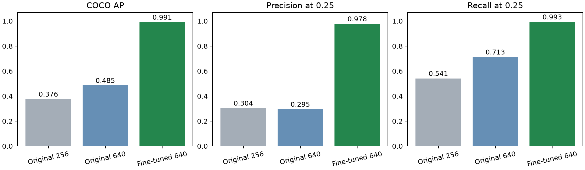
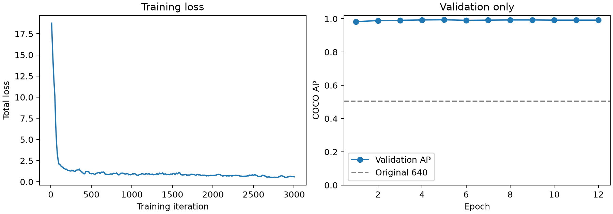
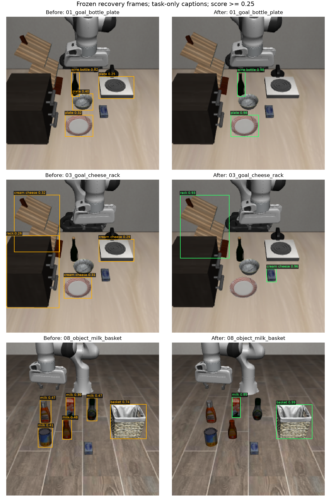

# LIBERO Grounding DINO 微调（2026-10-15）

本轮只训练和评估 RGB 类别检测。深度、SAM2、目标绑定和 recovery 控制器不在训练范围内。模拟器实例真值只用于离线生成检测标注和计算评估指标。

**12 轮训练和独立测试均已完成。** 同一评估入口、同一 250 张测试图上，原始 640 模型 AP 为 0.4853，微调后为 0.9910。最佳 checkpoint 来自第 5 轮，由验证集选出。

| 模型 | 测试 AP | Precision @0.25 | Recall @0.25 | 误检框 | 漏检实例 |
|---|---:|---:|---:|---:|---:|
| 原始 DINO，256 | 0.3758 | 30.37% | 54.12% | 933 | 345 |
| 原始 DINO，640 | 0.4853 | 29.50% | 71.28% | 1,281 | 216 |
| 微调 DINO，640 | **0.9910** | **97.77%** | **99.34%** | **17** | **5** |

这些是 8 类仿真资产上的离线检测结果，不能等同于完整 recovery 成功率。Hugging Face 兼容导出尚未通过推理一致性检查，不作为可直接部署的产物。



## 位置与来源

- SSH：`ssh -p 5476 -i "E:\服务器文件\shared_key_5476" root@101.132.180.249`
- 全部服务端新文件位于 `/mnt/nas/gezuhao/xinghanbo`，没有向既有环境安装包或更改全局变量。
- 分支：`feature/rgbd-recovery`；基础 commit：`62e4bc8410bcf1211c8b86dc8263746f2c8a6795`。同步内容包含当前工作区尚未提交的改动，因此 commit 本身不足以重建实验；应同时保留 `code_snapshot_manifest.json`、源码归档及后续脚本覆盖文件。
- 代码快照：`code_snapshots/rgbd_dino_finetune_20261015`。
- MMDetection：`code_snapshots/mmdetection_rgbd_20261015`，固定上游 commit `cfd5d3a985b0249de009b67d04f37263e11cdf3d`。
- 独立 uv 环境：`envs/rgbd_dino_mm_20261015`。框架依赖最终也装入该环境；早期下载尝试的 `envs/rgbd_dino_mm_deps_20261015` 不用于运行。
- 数据：`datasets/rgbd_dino_20261015`；模型：`models/rgbd_dino_finetune_20261015`；过程记录：`logs/rgbd_dino_finetune_20261015`。
- 官方 MMDetection tiny 权重：`groundingdino_swint_ogc_mmdet-822d7e9d.pth`，691,901,857 字节，SHA256 `822d7e9db9ce6ff2119b72dc6e78606a1b0a2c307234798adf0cab50f1b424e3`。BERT 参数从该权重提取，tokenizer 使用之前官方入口审计留存的 BERT 文件。

## 数据与质检

采集 `libero_object`、`libero_goal`、`libero_spatial` 共 30 个 task，每个 task 选 6 个官方初始状态（0、9、19、29、39、49），每个状态采 10 帧。机器人执行固定随机种子的短动作，8 帧来自 agentview、2 帧来自手腕相机；每帧保存原生 640 RGB、配对 256 RGB、实例 mask 和物理状态。

类别固定为 `wine bottle, bowl, plate, basket, rack, cream cheese, milk, orange juice`。标注包含这些类别的所有可见实例，框紧贴可见表面；不补全遮挡区域。隐藏实例不标框。其他物体仍出现在 RGB 中，构成检测背景。

类别映射沿用选中的 LIBERO 资产类别。例如 `Ramekin` 在 benchmark 中是独立类别，本轮不并入 `bowl`；butter、ketchup、tomato sauce 等也未纳入这 8 类。因此指标代表这 8 类的检测能力，不代表所有 LIBERO 对象或所有任务的覆盖率。

试采时发现分割图抗锯齿混色会产生错误几何 ID，形成跨越多个物体的大框。修复方法是使用单独、不带抗锯齿的标注渲染上下文，RGB 渲染设置保持原样。10 张修复前后 RGB 的像素 SHA256 全部一致，修复后错误大框消失。错误试采目录不参与训练。

预期从 1,800 张候选中选出 1,000/250/250 张训练、验证、测试图。按初始物体布局分组，并将相同 RGB 合并为同组后划分，避免同一 episode 或相同布局跨集合泄漏。最终数量、类别分布和分组交集以数据目录 `dataset_audit.json` 为准。之前反复查看的 9 张 recovery 诊断图作为独立诊断材料，不作为本次测试分数。

局限：这是相同仿真资产上的场景适配，主要覆盖初始布局及机器人短动作。它不能单独证明真实图像、未见物体资产或完整 recovery 轨迹上的泛化能力。

## 训练和评估约定

冻结 BERT 参数并关闭其训练 dropout；训练视觉骨干、跨模态融合和检测部分。查询混合完整 8 类、随机子集和单类，单类查询包含不存在于画面的类别；只保留查询涉及类别的真值框并重新映射类别编号。

先短训练验证梯度、损失、文本冻结和负查询，再完整训练 12 epochs；根据验证集 COCO bbox AP 保存最佳 checkpoint。共享 GPU 的实际批量和梯度累积数以运行目录保存的 `config.py`、`launch_manifest.json` 为准，不抢占或终止其他人的任务。

在同一个独立测试集上比较原始模型 256、原始模型 640、微调模型 640。报告 COCO AP、IoU 0.5 的分类匹配 precision/recall/F1、机器人误检代理指标，以及支持且双方可见的目标/支撑物匹配率。阈值由各自验证集选择，测试集不参与选阈值或 checkpoint；同时保留统一 0.25 阈值的结果。

机器人误检代理指标定义为：未匹配任何同类别真值且预测框内部超过 50% 像素属于机器人。这是显式统计口径，不能覆盖全部机器人误检。

最终训练、验证和三组测试阶段的返回码均为零。早期失败/无效短训及被替代的阶段保留在状态记录和历史日志中；它们不作为最终训练成功的证据。

本轮产物采用 MMDetection checkpoint 格式，可用本轮提供的推理/评估入口加载。现有 recovery 的视觉后端使用 Hugging Face 模型目录，不能直接把 `.pth` 路径替换进去；后续需完成权重兼容导出或后端适配，并重新核验推理输出。本轮没有替换线上/默认检测器，也没有运行微调后的完整 recovery。

本轮微调模型只在原生 640 输入上完成独立定量测试；现有流程若仍使用 256 输入，需要另行测试，不能直接沿用 640 的分数。

## 已完成的数据核对

最终 1,800 张候选对应 180 个布局分组。分组池为 1,200/300/300 张，从中选取 1,000/250/250 张。三个集合均覆盖全部类别，640 测试集共 752 个可见实例框。

按固定上游转换脚本，将之前审计过的 IDEA tiny 权重转换为 MMDetection 格式，903 个键和对应张量与本次官方 MMDetection 权重全部一致，无额外键、缺失键或数值差异。记录见 `logs/rgbd_dino_finetune_20261015/mmdet_weight_equivalence.json`。

## 执行命令

环境和数据准备完成后，在服务器执行以下命令启动一次实验。运行器只给子进程设置环境变量；每个阶段的完整参数、返回码和时间保存在 `logs/rgbd_dino_finetune_20261015/experiment_status.json`。

```bash
/mnt/nas/gezuhao/xinghanbo/envs/rgbd_dino_mm_20261015/bin/python -u \
  /mnt/nas/gezuhao/xinghanbo/code_snapshots/rgbd_dino_finetune_20261015/scripts/recovery/skill_pipeline/run_libero_dino_finetune_experiment.py \
  --root /mnt/nas/gezuhao/xinghanbo \
  --gpu GPU-97f96eec-562b-1e11-71e1-d64dd0bf6ec6 \
  --batch-size 4 --accumulation 1 --epochs 12
```

GPU 占用会变化，重跑时应先查看占用，再决定设备。中断后可增加 `--resume-completed`，它跳过记录中返回码为零的阶段；失败阶段原日志会保留。它不会从半个训练 epoch 自动恢复权重。

## 启动检查中的修复

1. Torch 2.1 的环境记录功能依赖 `pkg_resources.packaging`；setuptools 70 已移除该接口。项目环境固定到 setuptools 69.5.1，未修改系统环境。
2. 动态构建的 MMEngine Config 不会自动执行后添加的 `custom_imports`。训练入口显式导入自定义模块，钩子在 MMDetection registry 中注册。
3. 初始 AMP 短训虽能正常结束、损失有限，但 3 次更新对应的梯度范数均为 NaN。因此该短训被判定无效，不据此推进完整训练。改为官方配置使用的全精度 `OptimWrapper`。增加非有限梯度即终止检查，以及训练前后实际参数更新核对。

单图全精度短训已通过：3 次梯度范数为 70.1901、79.6798、121.4000；抽查视觉骨干 4,096 个参数全部发生有限更新，最大绝对变化约 `1.5024e-5`。文本参数可训练数量为零。随后检查 batch 4、累积 1 的配置，保持有效 batch size 为 4。

查询变换在真实 MMDetection box 类型上检查了 1,000 次：254 次空真值查询，同类别两个实例在查询包含该类别时均保留。训练集抽查 59 张 mask，重新计算的紧框及可见像素数与全部对应标注一致。

旧 9 帧 × 2 个 caption 的入口对照中，原始入口 85 个框有 82 个在 MMDetection 输出中找到 IoU≥0.95 的框。差异包括每实体 token 分数汇总、短语解码和框裁剪；这不代表输出逐项等价。权重张量等价已单独核验。

## 微调前验证集结果（非最终测试）

640 原始模型的验证集 COCO AP 为 0.5039，AP50 为 0.5312。固定 0.25 阈值时 precision 0.3339、recall 0.6598；验证集选择阈值后的 precision 0.8506、recall 0.5954。阈值提高能减少误检，但仍存在类别漏检。

各类 AP：wine bottle 0.7640、bowl 0.9356、plate 0.9556、basket 0.9915、rack 0.1089、cream cheese 0.0385、milk 0.0120、orange juice 0.2250。完整结果以 `models/rgbd_dino_finetune_20261015/evaluation/pretrained640/val/metrics.json` 为准。该结果用于记录基线，不是微调后的改善证明。

## 最终产物与独立测试

最佳权重（服务器绝对路径）：

```text
/mnt/nas/gezuhao/xinghanbo/models/rgbd_dino_finetune_20261015/training/best_coco_bbox_mAP_epoch_5.pth
```

文件大小 693,373,018 字节；SHA256：`12c97487fc59fcbf1da38b081c941e6024fa4f8af0c02e0e31cbc308c87b96b6`。

12 轮验证 AP 依次为：`0.983, 0.989, 0.991, 0.993, 0.994, 0.991, 0.992, 0.993, 0.993, 0.992, 0.992, 0.992`。第 5 轮被选为最佳，最终测试未参与选择。



| 类别 | 原始 640 测试 AP | 微调 640 测试 AP |
|---|---:|---:|
| wine bottle | 0.7548 | 0.9613 |
| bowl | 0.8861 | 0.9894 |
| plate | 0.9423 | 1.0000 |
| basket | 0.9467 | 0.9998 |
| rack | 0.0819 | 1.0000 |
| cream cheese | 0.0171 | 0.9875 |
| milk | 0.0191 | 0.9972 |
| orange juice | 0.2347 | 0.9928 |

按验证集选择的阈值评估，微调模型测试 precision 为 99.33%、recall 为 98.80%，对应 743 个正确框、5 个误检和 9 个漏检。统一 0.25 阈值下，机器人主体误检代理计数由原始 640 模型的 139 降至 0；这个代理指标不覆盖所有机器人相关错框，完整误检数仍应看 1,281→17。

对于目标与支撑物都可见且属于本轮类别的 114 对实例，双方都有正确检测框的数量由 104 提升到 114。这只衡量检测覆盖，不衡量语言关系推断、同类实例选择或运动执行。

最终参数核对：视觉骨干抽查的 4,096 个数值全部改变，最大绝对变化约 `8.3207e-4`；数值均有限。文本编码器抽查的参数变化数为零，可训练文本参数数量也为零。

## 原 recovery 帧复查

以下使用原先冻结的 RGB、相同任务类别 caption 和相同 0.25 阈值。可以看到奶酪不再被框到 rack/炉灶/盘子上，牛奶也不再泛指画面中的其他瓶罐。



原 9 帧中，04 的任务查询仍未输出盘子，05 仍未输出奶酪；是否因遮挡或可见面积不足导致，需要结合可见性进一步确认。09 仍有两个同类碗候选，后续需要根据任务关系选实例。不能将“类别检测改善”写成“9 个 recovery 已全部成功”。

## Hugging Face 导出状态

已提供 `export_grounding_dino_libero_hf.py` 和 `audit_grounding_dino_hf_export.py`。转换反向核对的 900 个 MMDetection 张量完全一致；HF 模型加载后的 1,056 个对应张量也逐项一致。文本 pooler、位置索引和去噪训练专用参数的处理在 `export_audit.json` 中逐项记录。

导出过程中发现 Transformers 4.40.2 的非共享回归头构造仍会创建共享对象，已在项目辅助加载函数中修复，不修改已安装的全局库。同时保留了编码器及最终解码器的分类分数缩放。

**但最佳模型的同输入推理一致性检查仍未通过。** 9 帧中最大 sigmoid 分数差约 0.00772，最大按 query 索引比较的归一化框差约 0.9993。差异是否主要来自低分 query 的排序/算子实现，尚未定位；不能据此宣称高分检测等价。服务器 `hf_export_best` 仅供诊断，不应替换默认检测器。早期无效导出也已标记。

当前可用、且本文所有定量指标对应的产物，是前述 MMDetection checkpoint。后续应先解决 HF 一致性或实现独立 MMDetection 推理适配，再进行真实 recovery 回归。

## 记录与复现材料

- 数据、模型和日志均保留在本文开头列出的服务器目录；没有改动系统环境或其他人的进程。
- `logs/rgbd_dino_finetune_20261015/experiment_status.json`：最终各阶段完整命令、时间、返回码及最佳模型路径。
- `requirements-lock.txt`：最终独立环境依赖锁定列表。
- `experiment_source_manifest.json`、数据 `manifest.json` 和源码覆盖清单：源码及采集来源哈希。基础 commit 之外的工作区内容必须一起保留。
- `results_review.zip`：轻量复查材料，含指标、源代码、配置、训练日志、数据划分/标注及诊断图；大模型权重和全部 RGB 数据保留在服务器，不重复打包。
