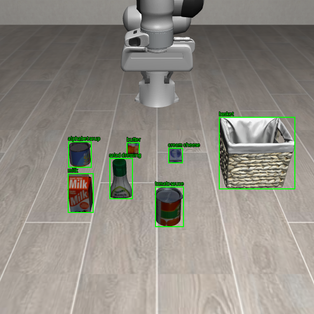
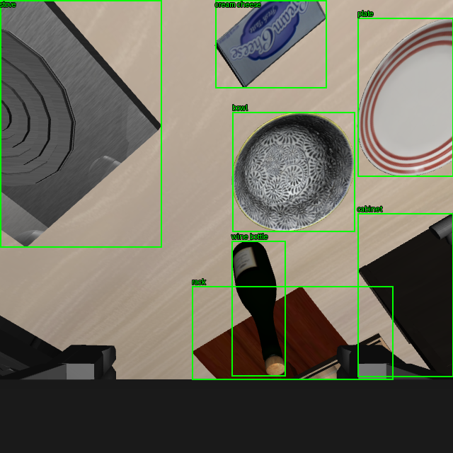

# LIBERO-Pro 全类别 DINO 微调（2026-10-18）

本实验已完成数据采集、12 轮正式训练和独立检测测试。训练端检测指标通过预设门槛；HF 导出逐框一致性未通过，尚未部署到 recovery。最终结果见文末。全部新资产位于训练服务器 `/mnt/nas/gezuhao/xinghanbo` 内；没有覆盖旧模型、旧数据和历史 benchmark 结果。

## 类别与范围

从上一批 Core-60 的 60 个冻结 BDDL 与初始状态文件逐一提取对象/fixture 类型，得到 19 类：wine bottle、bowl、plate、basket、rack、cream cheese、milk、orange juice、alphabet soup、salad dressing、tomato sauce、butter、bbq sauce、chocolate pudding、ketchup、cookie box、ramekin、cabinet、stove。table、floor 不作为本轮语义检测类别。

前 8 类为上一轮覆盖类别，后 11 类为新增。不同酱料独立标注；cookies 资产规范为 cookie box；akita_black_bowl 规范为 bowl。类别表包含任务表达别名，训练可在 canonical 名称和别名之间采样。drawer 目前作为任务中柜子的粗类别表达，不代表实现了抽屉部件检测或关节建模。

类别表与任务覆盖见 `dino_full_vocab_20261018_taxonomy.json`、`dino_full_vocab_20261018_coverage.csv`。

## 数据采集

使用相同 6 个 suite panel × 10 task，但重新选择初始状态索引：训练 6/12/18、验证 30、测试 42，共 300 个完整 VLA 回合。新验证/测试索引避开旧 8 类数据采集使用的 0/9/19/29/39/49，也避开之前反复查看的 benchmark 初始状态 0–4。

基础策略为 pi0_libero，沿用冻结 C4 skill 触发。采集器仅在真实触发时保存当前画面与离线标签，然后将控制权返回 VLA；**不执行 recovery 控制器，也不把这些回合视为 recovery 成功评测**。因此包含 VLA 运动/尝试抓取与真实 handoff 画面，但不声称覆盖了完整 recovery 执行分布。

每个回合初始时刻、控制步 10/35/60/85/110/135/160/185/210/235/260/285 及真实 skill 触发时刻，保存 agentview 与 wrist 原生 640 RGB、可见实例 mask 和完整仿真状态。提前结束的回合样本较少，不重复补成固定数量。每实例保留紧贴可见表面的框，完全不可见者不标框；微小可见碎片保留其 visible_pixels，评测时应结合目标尺寸分析。

身份真值只用于离线标注，没有送入 VLA。RGB 渲染保留原抗锯齿，标签使用独立无抗锯齿上下文，沿用上一轮已修正的标注方式。

采集结束后，以初始物体布局及相同 RGB 做联合分组，剔除跨 split 的重复样本；额外剔除与上一轮 8 类数据重合的 test 图像/布局。三个 split 均须包含全部 19 类，并确认训练集中包含真实 handoff 帧，才能进入正式训练。采集异常会留下失败日志，不将不完整回合混作完整样本。

两路仿真共享一份 VLA 权重，每回合随机状态独立。采集采用 GPU UUID `GPU-97f96eec-562b-1e11-71e1-d64dd0bf6ec6`，EGL 指定同一张物理 GPU（index 1）；未终止其他用户进程。实时可用显存会变化，启动时有足够余量。

## 环境与训练

独立 Python venv：

- `envs/rgbd_dino_full_20261018_sim`
- `envs/rgbd_dino_full_20261018_train`

二者通过本环境的 `.pth` 只读复用此前验证过的依赖与 editable 安装；不修改旧环境包、系统环境或全局环境变量。所有运行缓存显式指向项目 `.cache`，OpenPI tokenizer 使用已有项目缓存。启动早期发现默认 OpenPI cache 会落到 root home，已停止该次启动并归档其未完成下载，改用进程级 OPENPI_DATA_HOME 后重启。当前采集入口还修正了可编辑依赖的加载。

正式训练从原始 MMDetection Grounding DINO tiny 权重开始，BERT 冻结；全精度 AdamW，12 epochs，batch 2 × accumulation 2，有效 batch 4，学习率 5e-5，验证集选择最佳 checkpoint。类别数量与映射从 COCO 标注加载，三个 split 必须一致，防止仍按旧 8 类训练。查询混合完整类别、子集、单类和不存在类别，并采样任务中使用的类别别名。

正式训练前有 12 iteration smoke check。另启动了一次仅 6 张启动样本的 3 iteration 集成检查，输出到 `pilot_smoke`；该小样本数据在 smoke 中复用 split，仅检查接口与梯度，**不提供任何精度结论，也不作为正式模型初始化**。

## 自动执行链与验收

主任务会依次完成：300 ep 采集 → 数据防泄漏/类别覆盖检查 → 短训 → 正式训练 → 原始模型、旧 8 类模型、新 19 类模型在相同新 val/test 上评估 → HF 导出。

独立后续任务等待训练链完成，再使用 HF 4.40.2 进行同一 val/test 检测评测并匹配有效输出。检查 IoU≥0.95、分数差≤0.02、有阈值边界容差的匹配数量与 AP 差≤0.002；不将低分 query 的框差直接当作部署失败。

报告总体与逐类 precision/recall/AP、机器人误检代理、目标/支撑物实例对检测覆盖，以及任务提及类别集合的联合覆盖。最后一项只是检测可用性代理，不能当作关系推断或语义实例绑定正确率。

检测门槛单独记录：各类验证校准后的测试 recall≥0.90、总体 precision≥0.95、旧类别 recall 相比旧模型下降不超过 0.02，且导出验收通过。未通过时保留诊断，不自动替换 benchmark 默认模型。正式 recovery 复测尚未执行，需在检测与导出结果出来后进行，不能将训练启动等同整条 recovery 已修复。

## 服务器目录与状态

- 日志/协议：`logs/rgbd_dino_full_20261018`
- 源码：`code_snapshots/rgbd_dino_full_20261018`
- 数据：`datasets/rgbd_dino_full_20261018`
- 权重/评估：`models/rgbd_dino_full_20261018`
- `pipeline_status.json`：当前采集/训练阶段与错误。
- `collection_progress.json`：完整回合、帧数、handoff 帧数。
- `collection_probe_passed.json`：两回合启动检查通过证据。
- `validation_status.json`：后续 HF 验收进度。
- `final_detection_report.json`：最终检测/导出报告（尚未生成）。

主任务命令：

```bash
/mnt/nas/gezuhao/xinghanbo/envs/rgbd_dino_full_20261018_sim/bin/python -u \
  /mnt/nas/gezuhao/xinghanbo/code_snapshots/rgbd_dino_full_20261018/scripts/recovery/skill_pipeline/run_full_vocab_dino_experiment.py \
  --root /mnt/nas/gezuhao/xinghanbo \
  --gpu GPU-97f96eec-562b-1e11-71e1-d64dd0bf6ec6 --workers 2 --epochs 12
```

不要重复启动已有任务。当前入口的逐回合采集支持保留已完成项，但主训练调度器不支持安全重复执行已结束训练阶段；若任务中断，应先查明阶段再恢复。

本地分支 `feature/rgbd-recovery`，基础 HEAD `62e4bc8410bcf1211c8b86dc8263746f2c8a6795`，本轮未提交；冻结运行包来自 Core-60 的 `7128c1ea6280c227e48561e621fe9da8604c5a6d` overlay。确切运行代码以服务器快照及 SHA256 为准。

本地已通过动态 19 类/类别映射一致性、防相同 RGB 跨 split、HF 匹配类别与分数门槛三项测试；启动样本主相机与腕部标注图已人工查看，框与物体对应。另修复了本地 observed geometry hook 的错误处理顺序：先保存、检查拟合结果，再规范化长方体，避免缺旋转矩阵时抛 KeyError。该修改没有混入旧 300 ep 结果；初始绑定腕部补救与 next-to 规则调整尚未完成。

## 本次启动核验

2026-10-18 已通过两回合采集启动检查，正式队列放行。最近一次进度为 14/300 回合、334 张标注图、24 张 skill 触发帧。训练集/验证集/测试集均属于后续新采集，不是沿用上一轮截图。

独立 19 类 pilot smoke 已跑完三次更新；抽查 4096 个视觉参数中 4094 个改变、最大绝对变化约 1.502e-5，全部有限；抽查文本参数变化数量为 0。此短训产生的验证输出使用 smoke 数据，不能作为新模型精度结果。





## 00:36 进度检查

北京时间 2026-10-18 00:36：采集完成 66/300 ep（22%），累计 1350 张标注图，其中 skill 触发帧 126 张。已完成回合中 train/val/test 分别为 41/13/12；两路采集进程、共享策略服务和后续验收等待任务均存活，没有 failed.json，最近完成结果距离检查时约 17 秒。正式 12 轮训练尚未开始，后续验收仍在等待训练完成。快照见 `dino_full_vocab_20261018_status_66ep.json`。

## 正式训练与独立测试结果

300/300 ep 采集完成，共 7412 张图，含 446 张真实 skill 触发帧。训练/验证/测试分别为 4418/1508/1486 张，覆盖全部 19 类；物理布局与相同 RGB 分组检查通过，未发现需剔除的跨 split 重合。

12 轮训练返回码为 0，最佳 checkpoint 由验证集选自 epoch 10：

```text
/mnt/nas/gezuhao/xinghanbo/models/rgbd_dino_full_20261018/training/best_coco_bbox_mAP_epoch_10.pth
```

以下均来自相同新 19 类测试集、相同 0.25 阈值，不与旧 8 类测试集分数混用：

| 模型 | COCO AP | Precision@0.25 | Recall@0.25 | TP / FP / FN |
| --- | ---: | ---: | ---: | --- |
| 原始预训练 | 0.17033 | 18.58% | 32.30% | 2567 / 11251 / 5380 |
| 旧 8 类微调 | 0.41807 | 56.48% | 52.55% | 4176 / 3218 / 3771 |
| 新 19 类微调（MMDetection） | 0.97482 | 97.05% | 98.69% | 7843 / 238 / 104 |
| 新 19 类微调（HF） | 0.97471 | 97.09% | 98.67% | 7841 / 235 / 106 |

使用各自验证集校准阈值，新模型测试 precision 99.10%、recall 98.01%；各类 recall 都超过 90%，最低为 BBQ sauce 的 95.90%，旧 8 类也没有超出预设容差的 recall 回退。任务所需类别都可见的 982 帧中，953 帧检测齐全（97.05%）；这是类别集合覆盖代理，不代表语义实例绑定或 recovery 成功。

HF 导出已完成，但逐框验收未通过：val 匹配 8134 个候选、44 个未配对，test 匹配 8059 个候选、39 个未配对；按当前匹配算法，最大分数差分别为 0.183 和 0.430，超过 0.02。两个运行端 AP 仅差 0.000112，指标非常接近，但尚不能仅据此放行严格输出一致性检查。需进一步定位差异在实际推理还是候选匹配/重复候选处理，不修改既定门槛来宣称通过。

主流程与独立验收流程均结束；`export_passed=false`、`detection_acceptance_passed=false`，后者受导出门禁阻塞。没有自动替换 recovery 默认模型，也没有运行新模型的完整 recovery benchmark。下一步先解释、修复少量有效候选差异，再进行代表 recovery 回归。

完整机器可读结果见 `dino_full_vocab_20261018_final_detection_report.json`。
