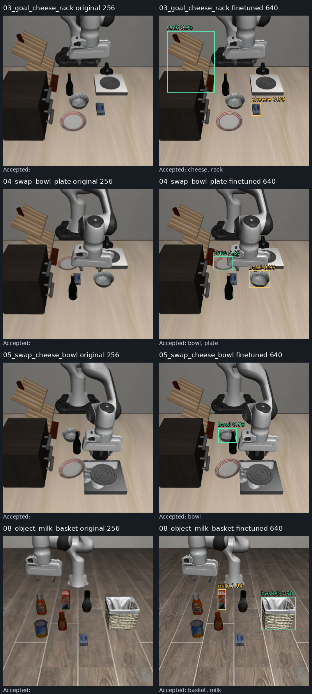
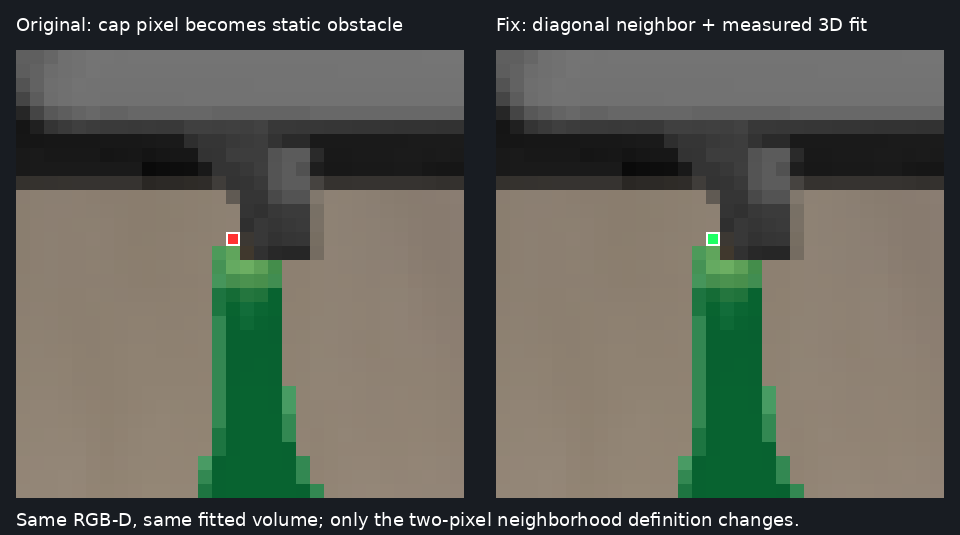
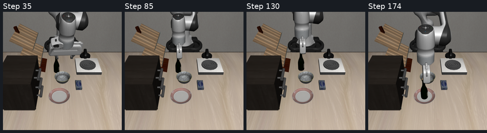

# DINO 微调模型接入 recovery：2026-10-16

本文记录 HF 导出验收、原生分辨率对照、冻结恢复入口回归。训练结果见 [微调报告](dino_finetune_20261015.md)。本轮不重新训练、不重新选择测试集阈值。

## 检测与导出验收

相同 250 张独立测试图、752 个实例、完整八类 caption。分辨率指原生渲染分辨率，检测器随后仍按原配置缩放到 800；没有把 256 插值放大后称为原生 640。

| 权重/运行端 | 原生分辨率 | COCO AP | Precision@0.25 | Recall@0.25 | TP / FP / FN |
|---|---:|---:|---:|---:|---:|
| 原始 / MMDetection | 256 | 0.37575 | 30.37% | 54.12% | 407 / 933 / 345 |
| 微调 / MMDetection | 256 | 0.95861 | 97.94% | 94.81% | 713 / 15 / 39 |
| 微调 / MMDetection | 640 | 0.99098 | 97.77% | 99.34% | 747 / 17 / 5 |
| 微调 / HF 4.40.2 | 640 | 0.99107 | 97.65% | 99.34% | 747 / 18 / 5 |

HF 在验证集选出的阈值为 0.425；测试得到 TP=743、FP=5、FN=9，precision=99.33%、recall=98.80%，与 MMDetection 的验证集校准结果相同。固定 0.25 阈值的一个 FP 差异仍保留，未将两种实现宣称为逐位相同。

旧九帧使用完全相同的输入张量，对高于 0.25 / 0.5 阈值的结果按类别做一对一 IoU 匹配。35 个有效框最小 IoU 为 0.999886，最大分数差为 0.000913，均通过预先指定的 IoU≥0.95、分数差≤0.02 检查。

逐 query 的原始框检查仍不通过，最大归一化框差为 0.9993。进一步记录发现，每帧有 29–73 个 query 的框差超过 0.005，但这些 query 的最高实体分数最多为 0.01351，远低于检测阈值。不能把这些低分 query 的框差解释为最终检测框错位；它们的精确数值差异来源仍未完全定位。

实体分数采用 MMDetection 的“类别词内 token sigmoid 概率均值”，随后选择 query/类别对。原 recovery 的 HF 自由短语解码使用另一种后处理，因此接入微调模型时必须同时使用这一实体后处理，不能只替换权重文件。

## 运行环境边界

训练服务器的 HF 4.40.2 已通过上述检查。原 recovery 的 HF 5.19 能经官方转换加载权重，但在同九张 RGB 上检测数量从 `[5,5,5,4,4,3,2,4,3]` 降为 `[2,2,1,0,0,1,0,1,1]`。原图哈希和 token 索引一致，处理后的像素张量哈希不一致；827 个同名权重逐项相等。此检查不足以将问题唯一归因于预处理或 Swin 实现，所以不在该版本直接启用转换权重。

采用独立 HF 4.40.2 检测进程，仅接收 RGB、明确的类别查询及阈值，返回框和类别。SAM2 保留原 HF 5.19 环境。目标服务器 Torch 2.7.1 的检测进程也使用原九帧完成了有效框匹配验收，随后才启动 recovery。全局环境与已存在的 Python 环境均未修改；新增依赖位于本次实验目录的 `dino440_deps`。

默认检测器保持原配置，转换权重通过 `--finetuned-export` 显式启用。HF 5 直接加载辅助函数会拒绝运行，避免把“权重能加载”误当作推理已验证。

## RGB-D 分辨率与接口

回放入口新增 `--camera-resolution {256,640}`，同时原生渲染 RGB 和深度；传感适配器按实际图像尺寸读取相机内参，对两者执行相同的方向转换。SAM2 掩码仍必须与原生 RGB/深度尺寸完全一致。诊断图的框缩放也改为依据实际尺寸，修复原先固定乘 3 只适用于 256 图像的问题。

十个任务的 640 传感帧均与旧 256 帧具有相同物理状态哈希、环境步和相机外参；内参恰好按 2.5 倍缩放，最大数值误差为 0。RGB、深度、有效性掩码尺寸全部一致，有效深度均有限。该检查证明本次分辨率切换遵守既有坐标约定，不是独立的真实相机标定精度测量。

最终共完成 20 项针对性检查，覆盖检测后处理、集合匹配、两种空检测边界、RGB-D 方向与保存接口、瓶盖归属及原生分辨率切换，全部通过。

## 恢复回归范围

启智仅操作用户指定的 `xinghanbo-eval`。使用 10 月 15 日相同十个任务的冻结物理状态、BDDL、控制配置和 C4 pack；先复跑锚点 256，再跑包含锚点的十任务 640。沿用的历史 GT 对照为 7/10 成功，本轮没有重新运行 VLA/GT rollout，不能把它写成本轮新获得的 GT 成功率。

RGB-D 回放开启本体空手、视觉实例 ID、目标/支撑物形状、观测障碍、视觉执行六项替换，并屏蔽控制流程中的仿真 reward/done。最终仿真成功仅作评测标签。所有未通过的任务均保留，不因历史 GT 失败或语言解析失败而删样本。

十任务 640 原始回归已完成，完整 recovery 为 **0/10**。首个检测候选缺失从旧流程的 7 例降到 1 例，有目标/支撑物绑定候选的任务从 2 例增至 8 例。这里的绑定候选存在不等于已用真值验证语义实例选择正确；后续阶段也不能视为通过。

| 案例 | 旧流程首个结果 | 本轮微调 640 首个结果 |
|---|---|---|
| 01 goal T4，瓶子→盘子 | 完整成功 | 运动规划失败 |
| 02 goal T7，瓶子→碗 | 缺瓶子候选 | 支撑物碗几何未支持 |
| 03 goal T8，奶酪→rack | 缺 rack 候选 | 奶酪/rack 几何未支持 |
| 04 goal_swap T4，碗→盘子 | 缺盘子候选 | 碗几何未支持 |
| 05 goal_swap T7，奶酪→碗 | 缺目标/支撑候选 | 仍缺奶酪目标候选 |
| 06 object T1，奶酪→篮子 | 缺篮子候选 | 奶酪/篮子几何未支持 |
| 07 object T3，果汁→篮子 | 缺篮子候选 | 果汁/篮子几何未支持 |
| 08 object T6，牛奶→篮子 | 缺篮子候选 | 牛奶/篮子几何未支持 |
| 09 spatial T2，碗→盘子 | 碗几何未支持 | 碗几何未支持 |
| 10 spatial T3，柜顶碗→盘子 | 语言解析未支持 | 语言解析未支持 |

本轮首个卡点计数：几何类型未支持 7、检测候选缺失 1、运动规划 1、语言解析 1。现阶段主要瓶颈已经转移到通用形状接口与闭环执行，继续微调分类器不会直接补齐这些功能。



图中标注的是 DINO+SAM2 经现有过滤接受的任务类别候选；未接受候选不等于原始 DINO 完全没有输出。此恢复对照同时改变了权重、HF 实体后处理和原生分辨率，不是仅修改权重的单变量实验。前文同分辨率、同 MMDetection 后处理的独立测试用于检验权重本身的改善。

对剩余 05 另做了冻结帧诊断：增加腕部视角、以及只查询任务中的奶酪/碗，均没有得到奶酪目标。agentview 的碗仍可见，腕部视角也未提供可用目标/支撑对。因此当前证据不能将它归结为“类别太多竞争”，也不能宣称切换腕部视角就已解决；后续需要单独核对目标的可见性和遮挡。本例也属于历史 GT 复跑未成功的样本，仍保留在十任务统计中。

## 瓶盖像素被误建为静态障碍

微调 256 锚点已经完成瓶子/盘子绑定与几何拟合，但两轮运动规划均失败，分别有 4、6 个满足优化约束的候选，全部未形成可执行轨迹。

与旧成功锚点对照：盘子拟合相同；瓶轴位置变化约 0.072 毫米、半径变化约 0.057 毫米、顶部变化约 0.330 毫米。额外的唯一静态障碍来自 RGB 像素 `(x=113,y=91)`，世界坐标 `[-0.218421,-0.048290,1.058351]`，位于瓶盖，且满足原有拟合体积加 2 毫米余量条件。

该点距掩码的曼哈顿距离是 3，棋盘距离是 2。原代码使用 SciPy 默认十字结构膨胀两次，实际只覆盖曼哈顿距离≤2，遗漏了图像中的斜向两像素邻域。隔离修复使用 3×3 结构膨胀两次，保留原有三维形状和 2 毫米约束；对这一冻结帧只新增归属上述 1 个像素，额外归属计数由 11 变为 12。



在 640 图像中，原规则还遗留了 7 个满足同一三维形状条件的瓶盖点，其中 2 个与掩码的棋盘距离为 3。原有两像素参数来自 256 图像，直接用于 640 会缩小实际邻域。因此隔离修复同时保持同视场下的参考邻域范围：256 使用半径 2、640 使用半径 5；三维拟合体积与 2 毫米余量均不变。实际半径写入障碍审计记录。

四项检查覆盖斜向瓶盖点、640 参考范围、拟合体积外真实障碍保留，以及离掩码过远的点不因落入形状范围而被删除。修复写入独立 `code_ownership8`，未混入十任务原始回归。

隔离 256 修复后，规划得到 16 个满足约束的候选并形成可执行轨迹，执行完成抓取和放置；在环境总步 170 时，退爪阶段当前 RGB-D 瓶子跟踪不足而拒绝继续。保存了 90 个执行视觉状态。独立仿真评测为成功，但在线 recovery 返回失败，因此**不计完整 recovery 成功**。这验证了瓶盖静态障碍修复能解除先前规划阻塞，也暴露了放置后跟踪的适用边界。

隔离 **640 修复后完整成功**：27 个满足约束的候选、139 个恢复环境步、退出码 0；恢复判据与独立仿真评测均为 true，保存 95 个当前 RGB-D 执行状态。

| 微调锚点配置 | 可执行规划 | Recovery 成功 | 独立评测成功 | 首个卡点 |
|---|---|---|---|---|
| 256，原归属规则 | 否 | 否 | 否 | 运动规划 |
| 640，原归属规则 | 否 | 否 | 否 | 运动规划 |
| 256，修复归属 | 是 | 否 | 是 | 放置后视觉跟踪 |
| 640，修复归属及参考邻域范围 | 是 | 是 | 是 | 本例完成 |

修复前后的 640 初始 RGB-D 文件、DINO 框、SAM2 掩码、瓶子拟合和盘子拟合均逐项相同。归属修复只将上述 7 个瓶盖点归还目标，残余点从 101,282 降为 101,275，静态障碍盒从 512 降为 511。这比仅观察最终成功更直接地定位了本次输入变化。

实际原生求解输入含 1 个视觉 ID 瓶子、2 个支撑物（桌面和视觉 ID 盘子）、511 个观测障碍，全部碰撞几何来源均为 `rgbd_*`。95 个执行状态均记录物体位姿来源为 RGB-D，没有使用运行时物体真值或接触输入；视觉 ID 未关联仿真物体名，仿真 reward/done 对控制流程保持屏蔽。静态机器人模型、当前本体信息、初始盘子近似静止及直立瓶子形状先验仍是本例条件。



这是 **1 个固定任务/初态的微调模型完整成功**，不是修复后重新获得的十任务成功率。十任务原始结果继续保留为 0/10，不把独立修复样例混入其分母。

## 路径与复现记录

训练/检测评测服务器：`/mnt/nas/gezuhao/xinghanbo`。

- 最佳权重：`models/rgbd_dino_finetune_20261015/training/best_coco_bbox_mAP_epoch_5.pth`，SHA256 `12c97487fc59fcbf1da38b081c941e6024fa4f8af0c02e0e31cbc308c87b96b6`。
- 本轮检测证据：`logs/rgbd_dino_integration_20261016`，含 256 验证/测试、HF 640 验证/测试、原始 query 与有效框诊断、完整参数及源代码。
- HF 导出当前的受限运行验收见 `models/rgbd_dino_finetune_20261015/hf_export_best/runtime_validation_20261016.json`；原 `DIAGNOSTIC_ONLY.txt` 保留了前一日的历史失败状态。

启智规范根目录：`/inspire/hdd/project/feelingai/chenwenming-25012/jxs/xinghanbo`。

- 本轮恢复实验：`logs/rgbd_dino_integration_20261016`。
- `recovery_batch.py`：校验传输 SHA256、目标运行环境一致性，再顺序启动锚点 256 和十任务 640；各运行的 `command.json` 保存参数与显式覆盖环境。
- `recovery_status.json`、`recovery_finished.json`：每次退出状态与批次完成标记；阶段统计见 `integration_summary.json`。
- `ownership_replay.py`：单独的瓶盖邻域修复验证，不混入原十任务结果。
- 成功案例目录：`anchor_ownership8_640`；`successful_anchor_verification.json` 保存求解几何来源、控制/评测结果及 SHA256；`ownership_controlled_comparison.json` 保存修复前后输入相同性核对。
- 成功案例结果 SHA256：`ee96102386e1b184e48478144f43badf3b67e39a57ca54a19a7279f52b477b5a`；原生 problem SHA256：`cb7d6742258e6d1ecef538bd9faa65b2f0dcacdcd255fb17c6454fea82818a2f`。
- 控制运行实现沿用 `logs/continual_skill_core60_pilot_20261006/runtime_repo`，本轮现场核验 Git 根目录与 commit `7128c1ea6280c227e48561e621fe9da8604c5a6d`，同时保留冻结运行补丁。
- 视觉代码来源为本地 `feature/rgbd-recovery`，基础 commit `62e4bc8410bcf1211c8b86dc8263746f2c8a6795` 加未提交工作区及本轮修改；不能仅靠此基础 commit 复现，必须同时保存源码归档、补丁与哈希清单。

本轮源归档 SHA256：`source_overlay.tar.gz` 为 `cf601f7f6c588985d5ff296f4141cca8cec08d41abc633b37cecf3266aa8c406`；传输模型归档 `hf_export_best.tar` 为 `1b6fdbb3ab467a8da0d190ae67a3550634cecfcf4a2ed0fa25e5bff625e68e7c`。这两个归档之外的集成补丁、实际运行源文件与独立修复也须保留。

完整复现命令见同目录 [启动脚本](reproduce_dino_recovery_20261016.sh)，脚本从成功运行保存的参数和环境生成，已通过 shell 语法检查。将其放到启智原实例，传入一个不存在的新输出目录：

```bash
ROOT=/inspire/hdd/project/feelingai/chenwenming-25012/jxs/xinghanbo
bash "$ROOT/logs/rgbd_dino_integration_20261016/reproduce_successful_anchor.sh" \
  "$ROOT/logs/dino_recovery_manual_replay_640_$(date -u +%Y%m%d_%H%M%S)"
```

该命令从冻结恢复入口开始，不加载 VLA 策略。依赖原实例上已保存的模型、冻结控制运行目录、静态机器人资产与历史 fixture；仅复制脚本和基础 Git commit 不能独立复现。

全部实验结束后，平台将同一实例从 `qb-prod-4090-gpu125` 重调度至 `qb-prod-4090-gpu056`；未操作其他实例。完成标记、成功结果和共享盘文件均已复核保留。证据包额外保存十个任务的 30 个 BDDL/fixture 文件及各自 SHA256，避免只有命令而缺少确切恢复初态。
