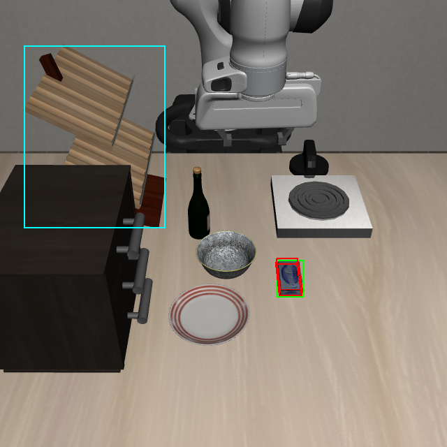
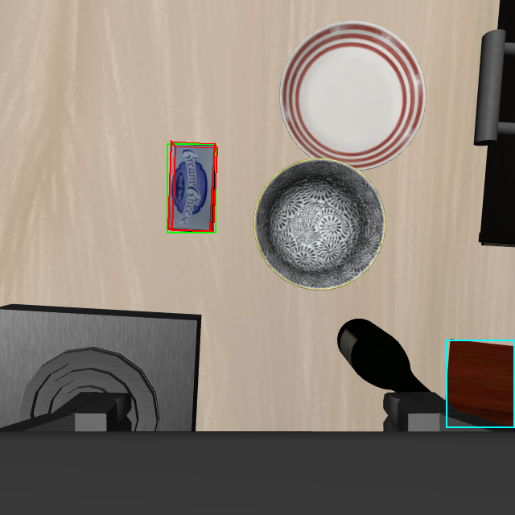
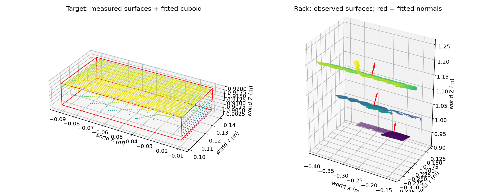

# 纯 RGB-D 盒状目标建模：奶酪→架子首轮验证

日期：2026-10-16。分支 `feature/rgbd-recovery`，基线 HEAD `62e4bc8410bcf1211c8b86dc8263746f2c8a6795`；本轮改动尚未提交。

## 本轮结论

完成了计划的第一关：以同一时刻的外部/腕部 RGB-D、DINO+SAM 掩码估计盒状目标，输出已有规划几何接口能够接收的形状。未读取目标资产、真值尺寸、真值位姿进行建模。

奶酪目标通过本轮可见表面拟合检查，统一几何转换检查通过；架子的支撑区域检查失败，所以本轮没有启动运动规划、抓取或放置。没有新增完整 recovery 成功案例，没有完整动作视频。

这次发现原先将“奶酪→架子”当作普通盒子到水平平面的起步任务不准确：实际观测中的主要架面倾斜约 30°，腕部还观测到约 14° 的另一表面。原成功例使用特定的命名放置区域和几何/执行提示，不能直接将其作为 RGB-D 检出的水平架面复用。

## 输入与实验隔离

唯一操作实例：启智「可上网GPU资源」的 `xinghanbo-eval`。本次启动前实时状态 RUNNING，节点 gpu056。没有创建或操作其他实例，没有安装依赖或修改全局环境。

服务器根目录 ROOT：

```text
/inspire/hdd/project/feelingai/chenwenming-25012/jxs/xinghanbo
```

本轮独立目录：`ROOT/logs/rgbd_box_geometry_20261016`。

输入为上一批 `rgbd_framewise_expansion_20261016/03_goal_cheese_rack/snapshots/recovery01/pre_solver_attempt01`，`libero_goal_task / task08 / ep00 / step55`。两个相机分辨率均 640×640，时间戳相同；这是 recovery 入口动作完成后的保存状态。本轮只读取保存帧，新增环境动作数为 0，没有重跑策略。

新目录的基础源码复制自成功瓶子案例 `rgbd_framewise_20261016_replay03/code`。在新目录重跑两视角 DINO/SAM 感知，得到完整候选和掩码，再运行独立的几何检查。模型权重、阈值、显式场景类别协议沿用历史配置，不为这个案例人工画掩码或替换类别。

建模程序仅接收 RGB-D、检测产物和语言；离线真值比较由另一个程序在几何结果保存后进行。原 frozen runtime commit 及 backend SHA256 在打包时再次核验一致，没有覆盖历史代码或证据。

## 方法

1. 验证检测产物的帧号、相机和 RGB SHA256 与传感器输入一致。
2. 掩码内有效深度反投影到世界坐标；侵蚀 1 像素边界，使用当前机械臂本体信息推导的基座坐标做既有工作空间裁剪。没有为物体指定固定尺寸。此例目标与机器人无明显掩码重叠；尚未在目标被夹爪大面积遮挡时验证分割和剔除。
3. 以可见表面的 RANSAC 平面估计盒体方向，要求存在三个近似正交的面方向；根据可见范围拟合盒体中心和尺寸，检查表面残差、解释比例和交替采样稳定性。不强制目标世界竖直。
4. 两视角同类别候选唯一时，仍需检查三维表面重叠：至少 20% 点距已有表面小于 4mm 才允许融合。此例奶酪为 97.56%，架子为 70.47%。这不是通用多实例关联方案。
5. 拟合盒体导出 `shape=box`、半尺寸、世界中心、wxyz 姿态，送入已有 `estimate_object_geometry` 转换；验证 source 保留、局部中心为零、半尺寸一致。未调用运动规划求解器。
6. 支撑面先检查近水平面，保留所有拟合平面的法线和倾角。倾斜面没有被压成水平面。即使发现水平候选，也不能仅凭凸包证明内部无孔洞；当前支撑检查尚未实现可放置足迹覆盖认证。

局部目标的最小面点数采用绝对下限，避免腕部的密集顶面观测淹没外部相机少量但真实的侧面证据。该问题在本轮初版融合检查中出现，已补回归测试并修正。旧的临时结果保留在本地 `local_audit01`，正式证据以服务器 `audit` 为准。

## 目标几何实测

按短、中、长三个尺寸排序，单位 mm：

| 输入 | 估计尺寸 | 离线尺寸参考 | 中心误差 | 盒体轴方向误差 | 本轮几何检查 |
|---|---|---|---:|---:|---|
| 外部相机 | 16.82 / 39.50 / 77.02 | 17.87 / 42.67 / 81.22 | 2.96mm | 0.98° | 通过 |
| 腕部相机 | 7.02 / 40.26 / 79.05 | 同上 | 5.96mm | 0.92° | 拒绝：不足以稳定约束三面方向 |
| 双相机融合 | 14.99 / 40.22 / 80.94 | 同上 | 2.47mm | 0.93° | 通过 |

融合目标有效点数 7,559；可见表面拟合残差 p95 为 0.985mm，交替采样尺寸差最大 0.450mm。碰撞代理每侧另加 1mm padding，该 padding 不参与上述尺寸误差计算。

融合后的三个尺寸比碰撞模型分别小 2.88 / 2.46 / 0.28mm。因此“通过”只代表本轮传感器几何检查通过，不代表完整隐藏形状被准确重建或抓取必然成功。盒状先验仍推断了不可见内部与表面连接，侵蚀与分位数裁剪可能低估尺寸；1mm padding 也不是误差上界。

中心比较使用当前传感器机械臂信息推导的世界/基座变换，误差含该变换的不确定性，不能称为独立标定精度。参考尺寸来自历史规划问题的碰撞盒，不是包装可见纹理的精确表面。







## 支撑区域卡点与真值对照

两相机融合架子点云没有找到满足本版近水平门槛的支撑面。其主要表面倾斜约 30°，另一个大平面约 14°。这说明检测和深度已提供倾斜形状证据，阻断并非再次发生在 bottle 类别检查；当前支撑适配器只处理近水平面，且没有解决多层表面选择与目标足迹覆盖。

离线检查历史成功规划输入发现：

- 目标放置面名为 `wine_rack_1_top_region`。
- 来源为 `libero_goal_task_wine_rack_top_region_site`，几何类型 `virtual_wine_rack_top_region`。
- 使用 `fixed_table_rect` 放置代理、命名区域对应边界，以及 `place_z_offset_m=0.095`。
- 启用了 `exclude_source_collision=true`，并包含指定的允许接触对象。

这些是历史成功的任务专用语义与几何处理，不是现场视觉估计。本轮没有把它们塞回视觉建模程序。

支撑检查结果明确为：

```text
target_geometry_gate = true
support_geometry_gate = false
execution_attempted = false
```

下一阶段需要从倾斜、多层的观测表面中选择任务放置区域，并将放置姿态、碰撞/接触和验收共同接入；不能直接让平面适配器把倾斜区域当作水平面。当前没有实现这一部分，也没有修改生产 recovery hook 让其他任务自动执行。

## 修改与验证

- 新增 `visual_observed_geometry.py`：纯观测的盒体和平面估计、显式质量检查、已有几何 schema 导出。
- 新增 `audit_observed_rgbd_geometry.py`：同步双视角、检测产物匹配、融合、图像/点云可视化、已有几何接口验证。
- 新增 `compare_observed_geometry_offline.py`：单独离线真值对照，不参与建模。
- `visual_task_binding.py` 新增几何输入绑定检查；感知诊断入口在几何拟合前调用，目标缺失时报告拒绝原因，不再继续查找空 ID 触发 `StopIteration`。
- 新增 7 项测试：倾斜盒体、单面不可确定厚度、相机采样密度不均、斜面不压平、水平面不自动认证孔洞、拒绝绑定和无效 ID。

服务器新旧相关测试共 21 项通过，几何检查程序和离线比较程序退出码均为 0。源码 SHA256 已核对，本地与服务器实际执行的 6 个改动文件完全一致。未重跑两个瓶子的完整物理动作回归，原完整 recovery 路径未改为使用新盒体模块。

## 复现与证据

在服务器源码快照目录，运行：

```bash
ROOT=/inspire/hdd/project/feelingai/chenwenming-25012/jxs/xinghanbo
RUN="$ROOT/logs/rgbd_box_geometry_20261016"
CODE="$RUN/code"
CASE="$ROOT/logs/rgbd_framewise_expansion_20261016/03_goal_cheese_rack"
export PYTHONPATH="$CODE"
export OMP_NUM_THREADS=2 OPENBLAS_NUM_THREADS=1 MPLBACKEND=Agg
"$ROOT/envs/rlinf-openpi/bin/python" \
  "$CODE/scripts/recovery/skill_pipeline/audit_observed_rgbd_geometry.py" \
  --snapshot "$CASE/snapshots/recovery01/pre_solver_attempt01" \
  --perception "$RUN/perception/recovery01/pre_solver_attempt01" \
  --language 'Put the cream cheese on the rack' \
  --out "$RUN/audit_reproduction"
```

完整感知命令在服务器 `perception_command.json`，测试/检查/比较命令在 `validation_commands.json`；当前文档对应的新检查不会移动仿真环境。

仓库内保存 `rgbd_box_geometry_20261016_{summary,comparison,target,support,commands,source_sha256}.json` 及三张图。

证据包：`ROOT/logs/rgbd_box_geometry_20261016/evidence.zip`，5,890,551 bytes，60 个文件加 manifest，SHA256 `e0b9c41e3b0dcd9b08142ecab89276b33c0387bdd8f46f76cf157b79a12492d7`。包含本轮源码、同步输入帧、检测/拟合产物和日志；历史真值规划问题单独作为离线参考归档。
