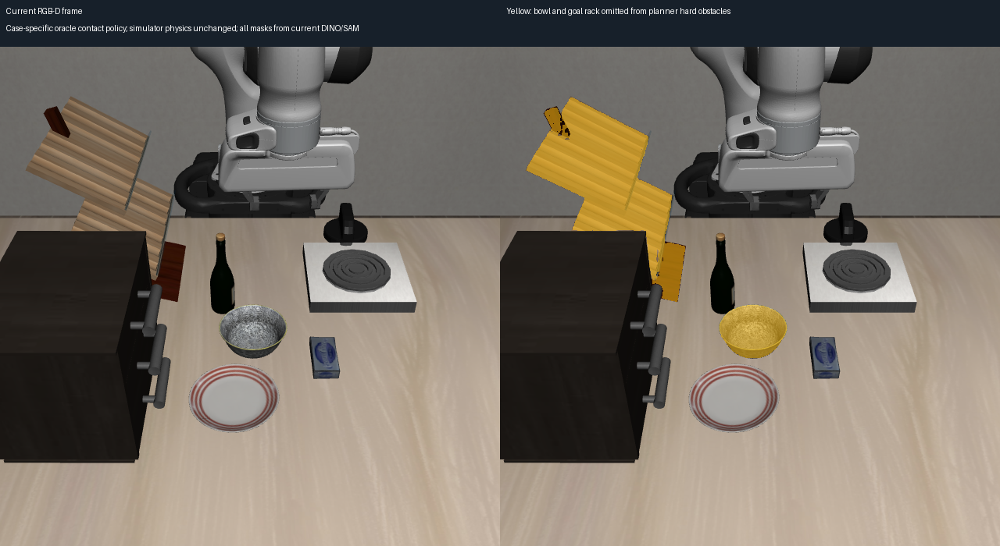
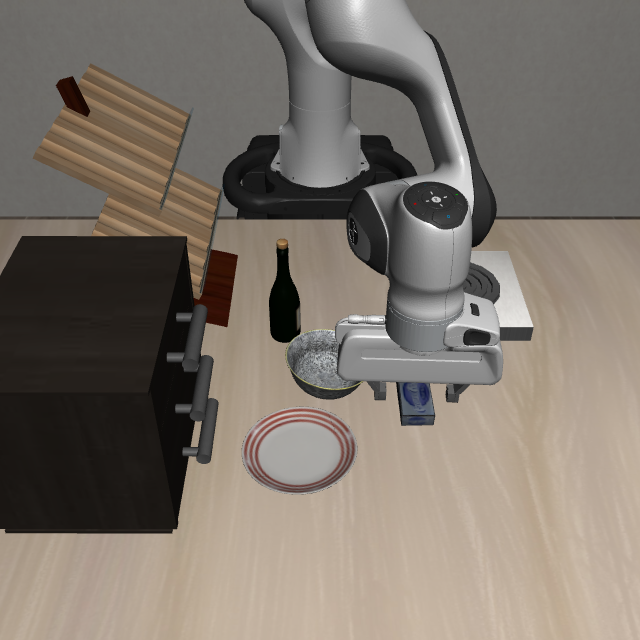

# 对齐真值接触规则后的 RGB-D 重放

用户授权后，将同一个奶酪—架子案例的 RGB-D 碰撞策略对齐历史真值成功案例：旁边碗作为允许接触物体、目标架子本体不作为硬碰撞障碍。仿真中的物理接触保持原状，只有规划碰撞约束发生变化。

## 实现范围

- 新策略名：`oracle_cheese_rack_contacts_v1`；仅在这个实验显式启用，默认仍为 `strict`。
- 从**当次 DINO/SAM 实例分割**绑定唯一 `bowl` 和目标 `rack`，将它们的观测点排除出硬障碍集合；不读真值物体 ID、位姿、site 或碰撞资产。
- 缺少或存在多个候选时拒绝静默应用规则。与其他硬障碍实例重叠的分割像素继续保留，并单独报告。
- 其他已标注实例继续参与原来的深度碰撞建模；未知物体仍沿用此前“只保留有标签物体”策略。
- 目标形状、斜面候选、释放余量和原生放置约束均保持 replay07 的版本。这一轮只检验接触规则的影响，没有引入真值上层 site 和 95 mm 高度偏移。
- 表面识别、目标建模、目标逐帧跟踪和机械臂本体信息仍走 RGB-D / proprioception。

这实现了接触对象排除规则的一致，不代表视觉与真值的所有几何、桌面代理或支撑区域已完全相同。

实现入口：`experiments/robot/libero/skill_pipeline/visual_collision_policy.py`。实验 hook 在体素化前应用像素所有权规则，避免按整个混合体素直接删除邻近硬障碍。每例保存 `collision_policy.json`、`collision_policy_masks.npz`、`strict_obstacles_before_policy.json` 与实际 `observed_obstacles.json`，可以复核被排除的类别、像素和障碍物数量。

## 运行和复现

仅操作启智 `可上网GPU资源/xinghanbo-eval`，根目录：

`/inspire/hdd/project/feelingai/chenwenming-25012/jxs/xinghanbo`。

本轮目录：`logs/rgbd_collision_aligned_20261017`。从 `logs/rgbd_rack_placement_20261016_replay07` 复制独立代码与冻结运行 overlay，只覆盖上述策略、策略测试、实验 hook 和驱动入口。原生后端保持 replay07 的 SHA-256 `8c5d1e22319b0b8fb02e227a362460a59e8e294157a2e856b40adcfda61dd994`。

驱动命令（在本轮 `code` 下，用项目 `envs/rlinf-openpi/bin/python`）：

```text
scripts/recovery/skill_pipeline/run_observed_rack_recovery.py
  --root /inspire/hdd/project/feelingai/chenwenming-25012/jxs/xinghanbo
  --run /inspire/hdd/project/feelingai/chenwenming-25012/jxs/xinghanbo/logs/rgbd_collision_aligned_20261017
  --collision-policy oracle_cheese_rack_contacts_v1
```

这是便于阅读的参数列表；可直接复现的完整 argv 在根目录 `launch.json`，各子实验的完整 argv 和子进程环境在 `plane_XX/command.json`。源码哈希在 `source_sha256.json`，变更边界在 `control_manifest.json`。使用原成功 ep 的物理初始化，三层候选并行推理、原生规划用共享锁串行，结果单独保存，不覆盖历史实验。

## 验证

本地及服务器的策略、障碍过滤、斜面、适配和目标跟踪共 19 项测试通过，包含仅排除指定实例、默认严格策略、歧义拒绝和重叠硬实例保留。

## 实际结果

三例均完成，19 项服务器检查通过。策略报告的原始硬障碍盒为 364 个，对齐后 176 个；观测障碍点从 83,617 降至 57,398。排除碗 4,500 像素、目标架子 21,772 像素，合计 26,272；本帧没有与其他硬实例重叠的像素。其余检测实例仍参与原碰撞建模。



本地比较新旧 `current_target_model.json` 和 `current_plane_candidates.json`，两份完整模型与 replay07 **完全相同**，不是为了通过求解更换了物体形状或放置点。桌面估计也相同。原生后端源码哈希保持一致。

| 候选层 | 原 On + HandEmpty 放置规划 | Holding 回退抓取规划 | 执行中断帧 | 整体 recovery / 仿真成功 |
|---|---:|---:|---:|---|
| 上层 plane_00 | 0/64 | **50/64** | 123 | 否 / 否 |
| 中层 plane_01 | 0/64 | **52/64** | 122 | 否 / 否 |
| 下层 plane_02 | 0/64 | **50/64** | 132 | 否 / 否 |

与上一轮 Holding 回退三例均无可行解相比，本轮三例都得到抓取计划，完成开启的 MotionGen，开始实际靠近、下探等动作。这里的 50/52/50 是各次原生求解的可行粒子数，不是重复试验成功率。三例在同一场景重放、只是原始放置候选层不同。

**完整放置规划仍卡在水平代理区域的 XY 约束**：三例均记录 `StablePlacement ..._in_xy <= 0.01 has 0/64 satisfying`。本轮按单因素实验保留旧放置约束，没有把释放候选仅用于初始化、水平区域不匹配的问题一起改掉。执行的是规划器随后选择的 Holding 回退，不是已经找到完整 Place 轨迹。

## 执行阶段的新卡点

三例都因 `framewise RGB-D registration unresolved` 抛错。错误帧的 DINO 返回类别均仅有 `bowl, rack, carton`，缺少 `cheese`，因此没有目标点云供 ICP 更新。`rejections=[]` 表示没有进入目标 ICP 拒绝列表，不能误写成“有 cheese 检测，但 ICP 残差不通过”。失败图显示夹爪在奶酪附近遮挡了部分视野；局部遮挡/视角变化导致漏检是当前图像支持的解释，尚未做逐帧检测归因消融。

- 上、中例手指总开度约 42.5 mm，已闭爪，末端抬到约世界 Z=0.9348 m，随后因目标漏检中断。
- 下例手指总开度约 77.2 mm，在下探操作附近仍张开时就漏检，不能说它也完成了闭爪。
- 没有完成抓取确认、完整放置或释放。三例均异常结束，没有运行预设的 60 步后续保持观察。



所以，这次已验证**接触规则不一致确实挡住了原来的抓取求解**；对齐后这道障碍消失，执行端暴露了“一帧检测缺失就中止”的脆弱性。后续应分别处理短时遮挡下的状态延续/重新观测，以及原生放置区域与视觉释放候选的约束映射；不应把本轮记为 recovery 成功。

视频按仿真控制步播放，省略真实推理等待：

- [上层例](assets/rgbd_collision_aligned_20261017/plane_00_recovery.mp4)
- [中层例](assets/rgbd_collision_aligned_20261017/plane_01_recovery.mp4)
- [下层例](assets/rgbd_collision_aligned_20261017/plane_02_recovery.mp4)

完整结果、规则报告和实际阶段见 [summary](rgbd_collision_aligned_20261017_summary.json)，精确命令见 [commands](rgbd_collision_aligned_20261017_commands.json)。远端证据包 `logs/rgbd_collision_aligned_20261017/evidence.zip` 含 366 个文件、13,670,634 字节，SHA-256 `c54621f2768c7e226cc8f03c19181d2a112016cfeae875ec7202cafb3280eb7d`。本地已核验 ZIP CRC 与全部内部文件哈希，见 [evidence](rgbd_collision_aligned_20261017_evidence.json)。
