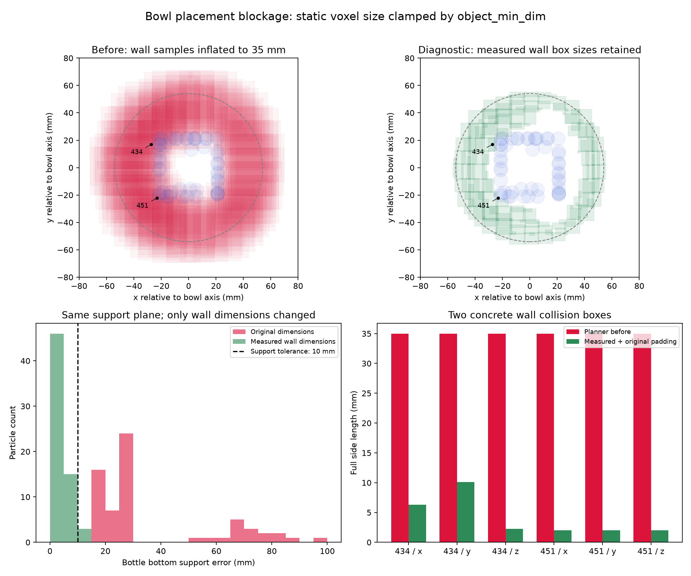

# 碗内放置失败：约束、碰撞盒与支撑面定位

日期：2026-10-16。分支：`feature/rgbd-recovery`。诊断对象为上一轮“只保留有标签障碍物”的 bowl recovery。此轮只运行离线规划对照，没有执行新的仿真动作，也没有修改冻结运行时。

## 结论

主要卡点是 **RGB-D 碰撞盒进入旧规划接口时被错误放大**。碗壁的毫米级观测盒使用普通物体的最小尺寸，三个方向都至少变成 35 mm，侵入碗内可用空间。规划器为避开这些盒子倾向于将瓶子留在碗底上方，于是碰撞约束与稳定支撑约束产生冲突。

保留全部 188 个碗壁盒，只纠正它们进入规划器的尺寸，不改支撑面、不放宽约束：两个种子分别从 0 个可行解变成 14、16 个满足约束的候选，规划结果均返回 feasible。**这证明了本次规划失败的主要原因；尚不能宣称修复后的完整 recovery 已成功。**



上两幅图是在同一个理想居中放置姿态下投影实际使用的碰撞代理，不是失败轨迹截图。蓝色为原生规划器的瓶子球体代理；右图保留全部碗壁观测盒。下左图为种子 0 的最终候选支撑误差。

## 失败的具体约束

原运行失败问题为 `rgbd_labeled_obstacles_20261016/bowl/cutamp_debug/solve_1792112151269_290884.problem.json`，动作包含抓取和放置。原日志中 `Collision.movable_to_world` 和 `StablePlacement.rgbd_bowl_obj_001_support` 均未通过。

重新固定种子 0 运行同一问题，64 个最终候选中：

| 检查 | 原尺寸转换 | 仅纠正碗壁尺寸 |
|---|---:|---:|
| 稳定支撑误差 ≤10 mm | 0/64 | 61/64 |
| 支撑误差最小值 | 16.126 mm | 0.068 mm |
| 支撑误差中位数 | 26.512 mm | 2.474 mm |
| 放置 XY 约束通过 | 60/64 | 64/64 |
| 物体对环境碰撞代价 ≤0.001 | 17/64 | 49/64 |
| 最终求解返回的满足约束候选 | 0 | 14 |

各行检查不等于共同满足全部约束；最后一行才是求解器的综合结果。碰撞阈值 0.001 是原生代价阈值，不应直接解释成“允许穿透 1 mm”。本次原生碰撞激活距离为 0。

种子 0 的机器人对环境碰撞代价全为零，因此这组最终候选的主卡点不是机械臂撞桌子。重跑优化轨迹会改变候选分布，不能要求新种子下各项失败计数与原日志逐项相同。

## 哪些碰撞盒有问题

场景共有 564 个静态盒：376 个环境观测盒，以及最后 188 个观测碗壁盒，编号 `rgbd_obstacle_0376` 至 `rgbd_obstacle_0563`。

| 盒子编号 | 观测完整尺寸 XYZ（mm） | 原规划器完整尺寸 XYZ（mm） |
|---|---|---|
| `rgbd_obstacle_0434` | 6.320 × 10.116 × 2.232 | 35 × 35 × 35 |
| `rgbd_obstacle_0451` | 2 × 2 × 2 | 35 × 35 × 35 |

434 的中心在机器人基座坐标系为 `(0.536757, 0.004820, -0.000130)` m；451 为 `(0.540906, -0.034381, -0.000045)` m。它们属于碗壁观测，不能因阻挡规划就直接删除。

代码位置：`experiments/robot/libero/tiptop_repro/real_cutamp_backend.py:306` 的 `_cuboid_dims`，尤其 325–327 行。非 surface 对象都经过 `max(cfg.object_min_dim, 2 * half_extent)`，配置中的 `object_min_dim=0.035`。RGB-D 静态小盒没有单独的 native collision parts，走 fallback cuboid 路径，也被套用了这个物体尺寸下限。

用瓶子原生的 50 个碰撞球，在居中直立、底部对齐目标高度的姿态检查：膨胀几何与 105 个碗壁盒有接触/穿透，测量几何仅有 1 个。434 的最大球盒穿透约 14.994 mm，恢复测量尺寸后则有约 2.021 mm 间隙。测量几何仍存在约 0.704 mm 的局部代理穿透，规划器可以调整姿态，不能声称所有近接触都消失。

此前粗筛的“69 个相交、测量尺寸下 0 个”使用瓶子包围盒；它是 AABB 重叠统计。这里的 105/1 使用原生球体代理，二者不是相同指标。

## 支撑面是否错误

本次目标是 `rgbd_bowl_obj_001`。RGB-D 测量碗底支撑高度在世界坐标系为 `0.9085164654` m，碗口约 `0.9495589432` m。

传给规划器的支撑面在机器人基座坐标系为：

- x 区间 `[0.527888067, 0.600131024]` m；y 区间 `[-0.048251979, 0.023990978]` m。
- 支撑 z 为 `-0.0033446696` m。原生稳定放置目标在支撑面上方 2 mm，因此瓶子代理底部目标 z 为 `-0.0013446698` m。
- 稳定支撑误差容限是 10 mm。XY 检查使用 surface AABB。原始 72.243 mm 宽的支撑区域还受 `surface_min_dim=80 mm` 扩展，这个独立近似值得后续审查，但本次对照完全没有修改它。

瓶子代理本体完整尺寸约 `42.367 × 42.335 × 154.950` mm；原生球体拟合的包围范围在每侧另扩展约 5 mm。因此只看原始瓶子矩形轮廓会低估规划器中的接触。

只纠正碗壁尺寸，支撑约束就恢复大多数候选通过，说明没有必要用“调低碗底”或“放宽支撑误差”来绕过此次失败。这里没有独立证明 RGB-D 碗底高度与物理真值完全一致。

## 离线对照结果与复现

所有对照使用同一个保存的问题、相同配置、原来的检测结果和瓶子模型。`exact_walls` 保留全部碗壁盒，保留观测半尺寸及其已有 padding，仅取消 35 mm 下限（数值下限 0.2 mm）。没有修改碰撞代价或支撑面。每个进程单独运行，补丁只存在于诊断进程内。

| 对照 | 种子 | feasible | 满足约束候选数 |
|---|---:|---|---:|
| 原尺寸转换 | 0 | false | 0 |
| 仅纠正 188 个碗壁盒 | 0 | true | 14 |
| 删除碗壁，仅作定位对照 | 0 | true | 22 |
| 纠正全部 564 个 RGB-D 静态盒 | 0 | true | 18 |
| 原尺寸转换 | 1 | false | 0 |
| 仅纠正 188 个碗壁盒 | 1 | true | 16 |

两个种子用于验证原因，不构成任务成功率统计。完整动作执行和仿真最终任务判定尚未重跑。

实例仅使用 `可上网GPU资源 / xinghanbo-eval`。服务器根目录：`/inspire/hdd/project/feelingai/chenwenming-25012/jxs/xinghanbo`。冻结运行时 HEAD：`7128c1ea6280c227e48561e621fe9da8604c5a6d`；诊断脚本为本工作区未提交的新文件。

```bash
export ROOT=/inspire/hdd/project/feelingai/chenwenming-25012/jxs/xinghanbo
"$ROOT/envs/rlinf-openpi/bin/python" \
  "$ROOT/logs/rgbd_constraint_diagnosis_20261016/diagnose_rgbd_bowl_constraints.py" \
  --reference "$ROOT/logs/rgbd_labeled_obstacles_20261016/bowl" \
  --problem "$ROOT/logs/rgbd_labeled_obstacles_20261016/bowl/cutamp_debug/solve_1792112151269_290884.problem.json" \
  --out-dir "$ROOT/logs/rgbd_constraint_diagnosis_20261016/solves_reproduction"
```

输出目录必须尚不存在。脚本从 reference 的 `command.json` 读取隔离环境配置，通过原 planning runner 启动 6 个子进程。实际命令、问题哈希及运行时 HEAD 记录在 `launch_command.json`、`solves/manifest.json` 和各个 `*.command.json` 中。每个种子 0 对照保存最终候选数组、约束记录和规划器实际碰撞尺寸。

## 下一步修复范围

让 RGB-D 静态观测盒按自身测量尺寸进入 native planner，明确区分“普通物体最小代理尺寸”和“观测体素尺寸”。保留碗壁、现有 padding 和支撑面，随后用同一个 episode 完整执行抓取—放置，并检查最终仿真任务判定。此次诊断没有把这个修改应用到正式运行路径。
