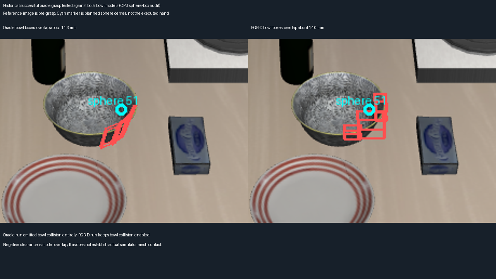

# 同一奶酪—架子案例：真值与 RGB-D 对照

这次对照发现：历史成功的真值案例没有检查旁边碗和目标架子的硬碰撞，而 RGB-D 版本检查了。因而此前不能直接把“真值成功、视觉失败”归因于检测或目标形状误差。

## 直接读取的实际规划输入、输出

历史真值输入位于启智根目录 `/inspire/hdd/project/feelingai/chenwenming-25012/jxs/xinghanbo` 下：

`logs/rgbd_ten_tasks_20261015/03_goal_cheese_rack/oracle/cutamp_debug/solve_1792034118342_67675.{problem,result}.json`。

RGB-D 参照为 `logs/rgbd_rack_placement_20261016_replay07/plane_00`。两者共享同一场景初始化资产，但恢复入口机器人状态存在小差别，关节最大差约 0.00706 rad；不是逐位一致的初始状态。

| 项目 | 历史真值成功案例 | RGB-D 案例 |
|---|---|---|
| 原生目标碰撞盒（长、宽、厚） | 81.22、42.67、17.87 mm | 84.94、44.22、18.99 mm，含 2 mm 单侧观测 padding |
| 目标中心 | 真值 | 对齐世界坐标后相差约 2.47 mm |
| 抓取 profile | `cream_cheese_flat_box_topdown_deeper_v2` | 同一个 profile |
| 旁边碗 | `excluded_allowed_contact_object` | 观测碰撞块启用 |
| 架子本体 | `excluded_target_support_surface` | 观测碰撞块启用 |
| 目标区域 | 真值 `wine_rack_1_top_region`、95 mm 高度偏移 | 观测斜面释放候选、6 mm 局部余量 |
| 原生求解 | 历史 33/64 可行 | 三层均无完整可行解 |

真值 goal metadata 明确包含 `allowed_contact_objects=["akita_black_bowl_1_main"]`、`exclude_source_collision=true`、`place_z_offset_m=0.095`。实际输出同时记录了碗和架子被排除，已经验证这不是仅写在配置里但未生效的字段。

真值碰撞几何仍会通过几何适配进入规划器；“真值”并不自动意味着所有物体都作为硬障碍物。这个成功案例实际采用了允许接触的规划策略。它的仿真成功仍然有效，但不能作为严格避开碗和架子的成功证据。

## 将历史成功抓取放回两种碰撞模型

直接取历史成功原生计划的 `q1`。使用已捕获的原生机器人碰撞球，拟合其固定 link-local 坐标，再经同一 Panda 静态 FK 转移到该关节姿态。在 64 个状态上拟合，并用另一组 64 个状态验证；最大球心误差分别约 0.39 和 0.43 微米。该计算没有再运行仿真、也没有把真值信息接入恢复算法。

| 同一个历史成功抓取姿态 | 辅助球—盒最小净空 |
|---|---:|
| 与真值碗的真实碰撞 box parts | -11.34 mm |
| 与 RGB-D 碗沿观测盒 | -14.05 mm |
| 与真值架子 box parts（抓取时） | 未发现 2 mm 内接近 |

最主要重叠来自机器人球 51；真值碗 part 为 `akita_black_bowl_1_g28` 等，观测块为 `rgbd_obstacle_0212`、`0193` 等。因此这个成功姿态在两种碗碰撞模型下都会产生模型重叠，RGB-D 的重叠更大一些，但不是凭空多出一个完全不存在的碰撞。

**这里说的是规划模型重叠，不是已经证明仿真夹爪实体穿进碗 11 mm。** 原生碰撞球和观测体素都可能保守；真值本体 mesh/geom 接触需要另看模拟接触、实际夹爪形状和执行轨迹。历史成功可能包含可接受的擦碰，也可能是规划球比实际夹爪更宽。本次证据不能二选一。

## 原生受控对照

运行目录 `logs/rgbd_oracle_comparison_20261017`；逐项命令和输入 SHA 在 `*.command.json`。使用 replay07 的同一个冻结 overlay、相同真值 `q_init`、同一个原始求解配置，独立进程、随机种子 0。比较：原始真值、只恢复碗硬碰撞、恢复碗及架子硬碰撞、只把目标替换成视觉估计，以及视觉目标加碗硬碰撞。替换目标时先统一世界/基座坐标系，并转换 collision part；不直接比较不一致的局部轴。

这些都是保存问题的原生求解，不创建仿真，不执行机器人动作。`hard-rack` 对照只取消架子本体的碰撞排除，保留虚拟采样区域自身的原行为。

六组已经全部跑完：

| 对照（其余配置保持原真值） | 完整原生规划可行粒子 |
|---|---:|
| 原始真值，碗和架子排除硬碰撞 | **33/64** |
| 仅把奶酪目标替换成 RGB-D 估计 | **15/64** |
| 仅恢复真值碗的硬碰撞 | **0/64** |
| 视觉奶酪目标 + 恢复真值碗硬碰撞 | **0/64** |
| 仅恢复真值架子的硬碰撞，碗仍允许接触 | **1/64** |
| 同时恢复真值碗和架子的硬碰撞 | **0/64** |

这些是单次求解内的可行粒子数，不是任务成功率。三个可行结果都完成了原配置开启的 MotionGen，没有启用“MotionGen 失败也接受”的回退。只换视觉目标这一组仍使用真值环境、目标区域与接触规则，所以**不是完整纯 RGB-D recovery 成功**。

恢复碗硬碰撞时，最终捕获的 64 个粒子里，有 40 个在抓取配置上通过机器人环境碰撞检查，但抓取位置检查 0 个通过，最小位置误差 7.88 mm，高于 5 mm 门槛。只换视觉奶酪并启用碗硬碰撞，最小误差 7.07 mm，也全部未通过抓取位置检查。原真值配置则有 54 个粒子通过抓取位置检查。这个结果符合“在当前采样与预算下，避开碗与到达抓取位姿发生冲突”，不能据此认定任务在物理上无解。

单独恢复架子硬碰撞仍有 1 个可行结果，但放置配置的位置误差中位数从约 3.94 mm 增到 63.73 mm，只有 2/64 通过放置位置约束，物体环境碰撞检查仅 30/64 通过。因此架子显著缩小可行空间，却不是这轮最先令抓取完全失效的因素。RGB-D 放置还额外改变了目标区域和净空策略，需要另做相同支撑区域下的对照，不能从这 1 个解推断 RGB-D 斜面候选已经正确。

本轮实际结果中的几何日志已核验：恢复碗时，其表示变为 `mujoco_part_meshes`；恢复架子时架子本体也不再被排除，故开关确实进入了原生碰撞世界。

精确输入、环境和命令见 [commands](rgbd_oracle_comparison_20261017_commands.json)，原生结果及逐阶段约束见 [summary](rgbd_oracle_comparison_20261017_summary.json)，独立几何比对见 [geometry](rgbd_oracle_comparison_20261017_geometry.json)。远端证据包 `logs/rgbd_oracle_comparison_20261017/evidence.zip` 为 1,670,240 字节、56 个文件，SHA-256 `c03d32918367c8603059735d72be0cdfe7aa3b6c99b3e8f2cd3c8ff938b1c692`，本地已验证 ZIP CRC 和所有内部哈希，见 [evidence](rgbd_oracle_comparison_20261017_evidence.json)。

## 撤回此前尺寸下限的错误归因

上一轮检查 `_cuboid_dims` 后，误认为 35 mm 下限把视觉奶酪改厚了。但实际输出是 `mujoco_single_box_cuboid`，直接从 collision part 生成 18.99 mm 厚度，绕开备用尺寸入口。真值目标同样走 single-box 路径。**35 mm 扩大没有发生，不是当前失败原因。**

之前 12 次诊断中 `target_dims` 变体修改的是备用函数，没有改变实际目标碰撞盒，不能称为有效的目标尺寸消融；相关历史记录已加纠正，不删除原始实验数据。本地备用入口防护仍保留，但不将它计为这个案例的有效修复。

## 当前能支持的结论

检测出的目标形状在毫米尺度上接近真值。更大的实验差异在碰撞排除策略与放置区域语义。下一步需要先统一这些规则，分别检查保守碰撞球、观测体素 padding、允许接触的边界，再决定是否调整抓取候选；不能仅凭原先的成功/失败对比认定视觉检测坏了。
