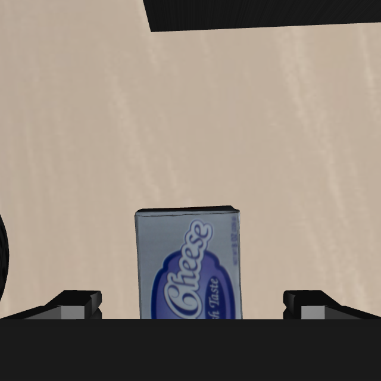

# 遮挡与画面裁切下的逐帧配准检查

本轮继续同一 cheese/rack 回合、已接入的历史 skill 视觉适配。指定实例仍为启智 `可上网GPU资源/xinghanbo-eval`，独立目录 `logs/rgbd_partial_tracking_20261017`，参考 `rgbd_saved_skill_20261017_v2`。不修改冻结源包或全局环境，不读取物体真值给 recovery。

## 失败帧检查

从前两轮已校验的证据包提取初始 RGB-D、目标 mask、失败时腕部 RGB-D/mask 和前一帧姿态，离线重算同一 ICP。旧验收要求全部初始参考点到当前观测点的中位距离小于 6 mm。腕部视角只看到部分目标时，初始表面中当前遮挡或落在画面外的点也进入该中位数，因此不能把约 7.8 mm 总体误差直接解释为当前可见表面对齐差。

| 保存失败帧 | 参考点总数 | 当前可评分参考点 | 可见参考误差中位数 | 当前观测到参考的误差中位数 | 相对前帧物体中心位移 |
|---|---:|---:|---:|---:|---:|
| saved_skill step 168 | 530 | 305 | 1.69 mm | 1.40 mm | 25.31 mm |
| saved_skill_v2 step 132 | 530 | 240 | 1.39 mm | 1.36 mm | 5.08 mm |

这里可见性来自该时刻的相机标定与深度图；前一帧位姿作离线种子，在线则还使用本体位姿增量推进种子。离线结果不能直接当成已验证在线轨迹。首帧虽可见误差低，但位移大，仍应拒绝；第二帧符合有界的部分观测更新。

[离线新评分](rgbd_partial_tracking_20261017_offline_new_quality.json)、[可见性诊断](rgbd_partial_tracking_20261017_visibility_diagnosis.json)。曾试算缩小 ICP 对应点分位数，结果不能一致解决两帧，因此没有采用该改动；见 [分位数诊断](rgbd_partial_tracking_20261017_offline_trim_diagnosis.json)。本轮线上仍用原始 ICP。



## 实现

新增显式开关 `--occlusion-aware-tracking`，默认关闭。原始 ICP 和验收先执行；只在原验收失败时，尝试部分观测验收：

- 将变换后的参考点投影到当前相机，剔除画面外、无效深度，以及比当前深度后方超过 4 mm 的点。
- 至少保留 40 个且不少于参考点 20% 的可评分点；只有至少 20% 初始点不可评分时才启用此分支。
- 可评分参考点误差中位数仍小于 6 mm，12 mm 内重叠率高于 80%；当前观测点到参考的误差中位数小于 4 mm、90 分位数小于 10 mm。
- 物体中心相对当前本体增量种子的移动小于 20 mm，旋转小于 15°。保留身份歧义、短时预测、失败停止及成功确认的原行为。

接受的帧写入 `acceptance_mode=depth_visible_partial_surface`、完整 `visibility_check`，明确部分位姿依赖前帧与本体种子约束，不声称当前单视角充分观测了全部 6 自由度。原先缺失目标时的预测仍标为未观测，不能用于抬升或成功确认。

本地/服务器相关 34 项测试通过，包括遮挡点不误罚、缺失的前景不能假装成遮挡、错误点云/全隐藏姿态/过大位移仍拒绝。两个保存失败帧离线评分分别拒绝、接受，不是统一放大 6 mm 阈值。

## 复现

分支 `feature/rgbd-recovery`，基线 `62e4bc8410bcf1211c8b86dc8263746f2c8a6795`，本轮修改未提交。冻结运行 overlay 来源 `7128c1ea6280c227e48561e621fe9da8604c5a6d`，精确代码以本轮快照、`source_sha256.json` 为准。

```bash
ROOT=/inspire/hdd/project/feelingai/chenwenming-25012/jxs/xinghanbo
RUN=$ROOT/logs/rgbd_partial_tracking_20261017
cd "$RUN/code"
PYTHONPATH="$RUN/code" OMP_NUM_THREADS=1 OPENBLAS_NUM_THREADS=1 \
 "$ROOT/envs/rlinf-openpi/bin/python" \
 "$RUN/code/scripts/recovery/skill_pipeline/run_observed_rack_recovery.py" \
 --root "$ROOT" --run "$RUN" \
 --collision-policy oracle_cheese_rack_contacts_v1 \
 --tracking-gap-steps 10 --tracking-gap-seconds 0.5 \
 --wrist-fallback --occlusion-aware-tracking --rack-skill --plane-ids plane_00
```

复跑应另选目录并使用对应代码快照。完整命令及环境记录在 `replay_driver.command.json`、`plane_00/command.json`。沿用 skill 区域 resolver、观测架子净空、原碰撞接触策略，仍未恢复架子严格硬碰撞，不能把规划可行解释为已保证执行避碰。

## 在线结果

**该回合完成了抓取、抬升、搬运、下降与松手，仿真判定成功；随后 60 步静置期间的 7 次评估也全部保持成功。** 末帧可见奶酪留在架子上。完整在线耗时 398.68 秒，无进程错误，末控制步 272。

- 完整原生 On 计划 31/64 可行；这是粒子数，不是成功率。本轮求解含采样差异，不能把可行粒子数的变化归因于跟踪评分。
- 实际抬升后末端高度约 1.313 m，观测物体底部约 1.294 m，高于整个观测架子顶部约 50.0 mm，超过原有 40 mm 净空门槛。
- 执行器实际使用 `rgbd_saved_skill_inner_bounds`；松手前 release check 为 true，随后 `opened=true`。本轮验证了前一轮尚未走到的 skill opening 执行分支。
- 全程 217 个跟踪帧均为 `observed`，其中主视角 194 帧、腕部 23 帧，没有借助未观测预测状态完成任务。
- 原验收通过 215 帧；新部分可见验收实际通过 step 195（下降）和 196（张爪）。对应可见参考误差约 1.54/1.39 mm，物体中心相对种子变化约 4.53/0.20 mm，转角约 1.08/0.72°。

### 为什么 controller 的 recovery_success 仍为 false

本轮 `final_simulator_success_for_evaluation=true`，但 `recovery_success=false`。这是两个独立判定：当前纯视觉确认器要求物体底面在初始已观测支撑占用网格上的覆盖率至少 97%；本轮静置后的覆盖率约 **70.30%**，因此视觉确认仍拒绝。它的张爪、静止、接近表面、位于观测 envelope 内这四项检查全部通过，最小有符号表面距离约 +3.34 mm。

没有把该阈值改到 70% 来回填成功，也没有让仿真成功信号驱动控制。成功结论限定为**这个 RGB-D＋历史 skill 视觉适配回合的仿真任务成功**；纯视觉自动成功确认尚未闭环，不等于任意任务的通用成功率已经建立。当前 skill 使用上层区域的矩形代理，而视觉确认使用斜面占用网格；这两个区域表达及网格对可见空隙/遮挡的处理仍需后续对齐。

### 视频与证据

[完整视频](assets/rgbd_partial_tracking_20261017/recovery.mp4)按仿真时间播放，省略推理等待，包含额外静置。[末帧](assets/rgbd_partial_tracking_20261017/last_rgb.png)、[精简结果](rgbd_partial_tracking_20261017_summary.json)、[静置后视觉检查](rgbd_partial_tracking_20261017_post_settling_visual_check.json)、[实际驱动参数](rgbd_partial_tracking_20261017_replay_driver.command.json)、[源码哈希](rgbd_partial_tracking_20261017_source_sha256.json)。

证据包包含 405 个文件，20,813,884 字节，已校验 SHA256、ZIP CRC 和逐文件哈希。归档 SHA256：`0edddcbc1214fd3db7fed48bd67692d4e60431abcc238f9f1ffac44a44b8c3f4`；本地位于 `assets/rgbd_partial_tracking_20261017/evidence.zip`，远端位于本轮日志目录。包含冻结源码、命令、原生输入输出、逐帧报告、关键 RGB-D 和腕部 mask。

运行结束后本地另修正了日志元数据：部分可见分支的本体位姿不只是 ICP 种子，还用于位移/转角边界，因此将该分支的 `robot_pose_used_for_registration_seed_only` 改为 false，并补充明确的 gate 标记。冻结运行报告中的旧字段仍为 true，应以该帧 `visibility_check` 和本段说明理解；没有改写原始日志或声称此元数据补丁已在线复跑。
