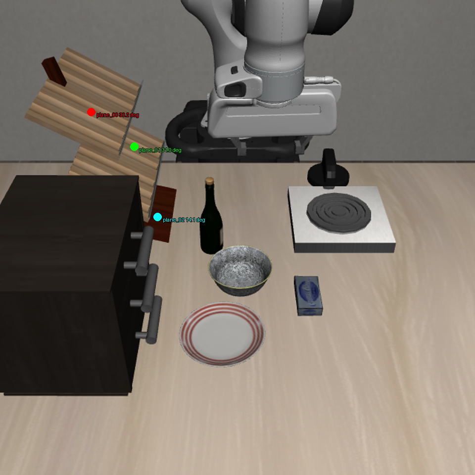
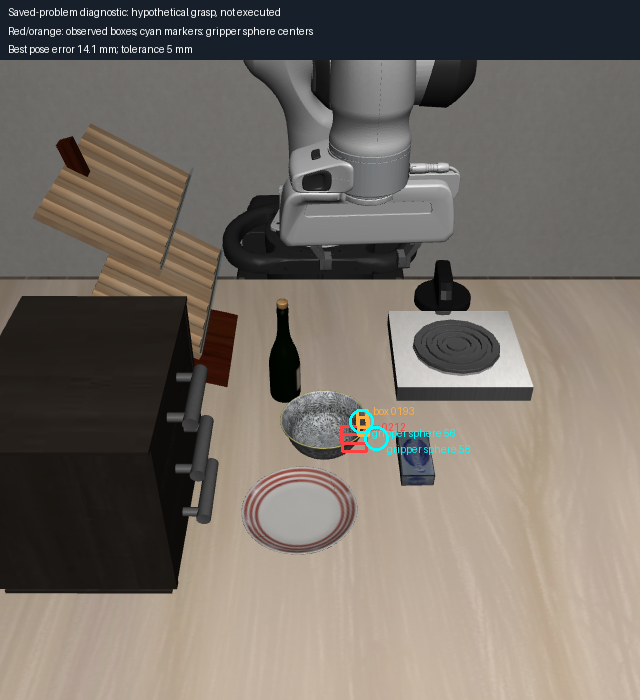
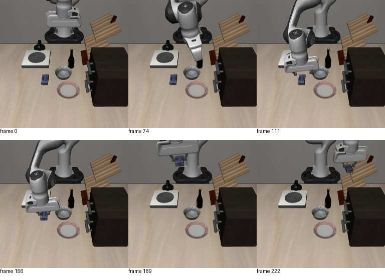

# RGB-D 奶酪—斜面架 recovery 实验

本轮沿用 `feature/rgbd-recovery`（基线 HEAD `62e4bc8410bcf1211c8b86dc8263746f2c8a6795`，实验改动尚未提交），继续纯观测形状路线。目标是从 RGB-D 重建奶酪和架子的局部表面，进入原生规划，再验证释放后的状态。**目前尚未获得该任务完整成功的纯 RGB-D recovery。**

## 输入与边界

- 仅操作启智 `可上网GPU资源/xinghanbo-eval`。
- 服务器根目录：`/inspire/hdd/project/feelingai/chenwenming-25012/jxs/xinghanbo`，以下远端路径均相对它。
- 冻结运行仓库 commit：`7128c1ea6280c227e48561e621fe9da8604c5a6d`；当前分支代码通过独立快照和函数级 overlay 接入，未替换历史运行包。
- 重放历史 oracle 案例的初始物理状态以保持相同场景；恢复算法不读取物体真值位姿、碰撞形状或架子目标 site。机器人关节、末端位姿和手指位置使用本体信息。仿真成功信号只作评估。
- 使用微调 DINO HF 导出 `logs/rgbd_dino_integration_20261016/hf_export_best` 和 SAM。实际 recovery 的初始目标形状及候选来自当次双视角检测；静态审计只枚举候选层编号。

## 已接入的流程

1. 当前 agentview 与腕部 RGB-D 检测、分割；通过重叠检查后融合观测点。
2. 拟合三组近似正交面，形成奶酪长方体及 2 mm 单侧碰撞 padding；目标朝向由观测决定。
3. 从架子点云提取斜面和占用网格；完整底面至少 97% 被观测网格覆盖才生成候选，不把大孔洞当成支撑面。
4. 根据底面下方最高斜面点加 6 mm 净空，生成直立悬停释放位置；这不是法向对齐的六自由度放置，也不保证释放后稳定。
5. 将候选转换到机器人基座坐标并初始化原生 cuTAMP。真实架子仍保留为带标签深度生成的碰撞体。
6. 执行观察接口支持每帧 DINO/SAM 与自由 SE(3) 跟踪；目标完成判定检查手指张开、观测表面关系和短时稳定性。

静态数据的上、中、下层倾角分别约 30.15°、31.01°、14.07°，在 2 mm padding 下分别产生 1、8、1 个候选。它们是几何候选，不能直接称为任务语义正确且动力学可行的放置点。

## 三层实际重放结果

运行目录：`logs/rgbd_rack_placement_20261016_replay07`。启动入口为其 `code/scripts/recovery/skill_pipeline/run_observed_rack_recovery.py`；精确各子实验命令和环境在各 `plane_XX/command.json`，源码哈希在根目录 `source_sha256.json`。

| 候选层 | 耗时（含推理、排队、观察） | Place 原生求解 | Holding 回退 | recovery / 仿真成功 |
|---|---:|---|---|---|
| 上层 plane_00 | 223.15 s | 0/64 可行 | 无可行解 | 否 / 否 |
| 中层 plane_01 | 232.04 s | 0/64 可行 | 无可行解 | 否 / 否 |
| 下层 plane_02 | 214.91 s | 0/64 可行 | 无可行解 | 否 / 否 |

三例都只执行了 15 步恢复入口动作，规划失败后额外观察 60 个保持动作步。**60 个跟踪帧不代表完成了抓取或释放。** 导出的视频仅显示入口动作与等待观察，不是成功恢复视频。原始结果中 `total_env_steps=15` 不包含这 60 步，因此不能只读这个字段统计总仿真推进。

早期 replay01—06 包含冻结运行接口不兼容、导入、检测来源枚举等接入故障，以及一次平台重启中断；不能计为六个任务失败样本。replay07 才实际进入完整原生求解。

## 已确认的接口问题

**放置候选只改了初始化，没有改约束。** 视觉端给出了通过占用网格检查的释放点，但 cuTAMP 仍检查水平面的 StablePlacement：球心必须落在代理矩形内，物体底部必须贴近固定高度。当前代理矩形人为设置为 30 × 30 mm，进入接口后又被下限扩大到 80 × 80 mm。这个矩形既不等于观测斜面，也不等于候选可行域。原始日志明确出现放置 XY 范围失败。

**2026-10-17 真值对照后的纠正：目标厚度没有被扩大到 35 mm。** 早先只检查了备用 `_cuboid_dims` 路径，误认为 35 mm 下限进入了实际求解。实际 `geometry_debug.objects[0]` 显示使用 `mujoco_single_box_cuboid`，直接读取 collision part，原生尺寸为 84.94 × 44.22 × 18.99 mm。真值原生盒按世界轴排序为 81.22 × 42.67 × 17.87 mm。备用路径尺寸防护不是当前失败原因；此前口头结论在此撤回。

原始三层日志同时有机器人/物体与环境碰撞、末端位置约束失败。因此不应仅扩大放置矩形，或关闭架子碰撞来换取求解通过。

## 对照诊断

2026-10-17 实例因平台自动回收处于停止状态，重新启动后，在 `logs/rgbd_rack_constraints_20261017` 对已保存的上层问题运行独立求解。入口为 `scripts/recovery/skill_pipeline/diagnose_observed_rack_constraints.py`；不创建仿真环境，不执行动作。

对照分别保留原配置、修改备用目标尺寸函数、仅把水平面约束替换为已验证候选的释放位姿邻域、以及两者组合；另对 Holding 问题修改备用尺寸函数。后续核实：备用尺寸函数的修改没有改变实际 single-box 目标几何，故这组不能被解释为“35 mm 变成 20 mm”的有效尺寸消融。释放对照保持真实环境碰撞和运动学检查，并要求同一个候选同时解释 XYZ 与 yaw，避免跨候选拼接。它检验的是悬停释放位姿，不代表稳定支撑。

各次精确输入 SHA、命令在诊断目录的 `*.command.json`；逐项代价在 `*/constraint_trace.json`，最终粒子在 `*/final_particles.npz`。诊断结果须以 `finished.json` 和实际捕获约束为准。

三轮共 **12 次独立诊断求解均完成，均未找到完整可行解**。后两轮目录分别为 `logs/rgbd_rack_constraints_20261017_check02` 和 `_check03`。这些是同一个保存场景的约束消融，不是 12 个不同任务，也不证明该场景在物理上无解。

| 对照 | 原生求解观察 |
|---|---|
| 原配置，40 步 | 上层放置 XY 检查 0/64 通过；抓取阶段位置误差最小约 12.15 mm |
| 修改备用尺寸函数（未改变实际目标盒） | Holding 抓取位置误差最小约 12.29 mm，仍高于 5 mm 门槛 |
| 修改备用尺寸函数与释放约束 | 27/64 通过释放 XY/yaw 邻域，24/64 通过释放 Z 邻域，但抓取位置检查 0/64，放置时物体环境碰撞检查 0/64 |
| 修改备用尺寸函数、优化次数增至 200 | Holding 抓取误差最小约 14.13 mm；更多优化未解决冲突 |
| 200 步并换较浅 v1 抓取 | 最小位置误差约 8.69 mm，仍无完整解 |
| 200 步并扩大观测盒内抓取采样 | Holding 最小误差约 1.07 mm，部分位置约束通过，但仍不能同时满足全部碰撞约束；完整 Place 仍失败 |

表中的“优化次数”是配置上限，仍受原生求解器时间预算与停止条件控制。不同对照的极小值来自各自粒子集合，不能拼接成一个可行解。初始化设为同一随机种子，但 GPU 几何采样不保证逐位重复；结论限于这些实际求解结果。

### 抓取冲突的具体位置

补充捕获机器人碰撞球与实际启用的世界 cuboid，按单次求解中抓取位置误差最小的粒子进行 CPU 球—盒有符号距离检查。重复出现的是 `rgbd_obstacle_0212`、`rgbd_obstacle_0193`，投影落在奶酪旁的碗沿。机器人球索引主要为 56、58；它们属于规划中的候选手部位置，**不是图中机械臂已经执行到的位置**。例如 40 步对照的球—盒净空约 -4.31 mm、-0.68 mm。这个辅助几何检查解释的是碰撞模型冲突，尚不能证明真实夹爪在仿真中一定碰碗。

### 释放冲突的具体位置

将原生采样的目标碰撞球刚性放到精确测量候选（而不是优化后漂移位置），上层候选仍与 `rgbd_obstacle_0115`、`0145`、`0132` 相交，最小辅助球—盒净空分别约 -7.13、-6.81、-6.35 mm。这些是架子上层附近的观测盒。当前候选仅保证对拟合斜面底面覆盖与 6 mm 高度余量，没有同时检查观测体素盒及原生目标碰撞球的完整包络，因此不能把该候选标为已通过三维碰撞验证。

完整几何数值在 [抓取接触诊断](rgbd_rack_placement_20261017_grasp_contacts.json)、[释放接触诊断](rgbd_rack_placement_20261017_release_contacts.json)。更合理的下一项实现是统一候选与原生求解的碰撞几何，显式筛选完整目标和夹爪净空；并依据可见形状生成避开邻物的抓取。不能通过删碗或删架子来替代这一步。

## 历史真值案例的解释

历史 oracle 目录为 `logs/rgbd_ten_tasks_20261015/03_goal_cheese_rack/oracle`。它使用特定上层目标区域、95 mm 放置偏移，并排除该来源的碰撞；**目标元数据还把旁边碗列入 `allowed_contact_objects`，实际原生输出明确将碗标为 `excluded_allowed_contact_object`。架子本体标为 `excluded_target_support_surface`。** 这些配置没有带入新 RGB-D 恢复，因此它不是同等碰撞约束的对照。其 Place 事件记录了 `opened=true, done=true, success=true`，不能称为没有发出释放。现有视频在这一事件后结束，不能证明长时间稳定；也不能因此否认历史仿真成功。

进一步对照见 [真值与 RGB-D 抓取、碰撞审计](rgbd_oracle_comparison_20261017.md)。

## 验证与后续门槛

服务器接入前 10 项测试通过；本地观测形状、斜面、候选适配、逐帧跟踪和尺寸回归共 20 项测试通过。它们验证几何与接口行为，不替代完整任务成功。

诊断结束后，本地为显式来源为 `rgbd_observed_cuboid` 的**备用目标尺寸入口**移除了尺寸下限，并补充回归测试；实际 single-box 路径本来已保留尺寸，这不是当前案例的有效修复。执行观察的目标判定现在也把非当前架子的目标委托给原检查器，避免错误用于回退目标。这两项是本地后续改动，**不属于 replay07 已执行的源码快照**；尚未宣称经完整仿真验证。释放约束替换和抓取网格扩展仍限定在独立诊断脚本内，没有把仅通过局部检查的轨迹接入真实执行。

精确命令与环境见 [commands](rgbd_rack_placement_20261017_commands.json)，完整指标见 [summary](rgbd_rack_placement_20261017_summary.json)。证据包为 replay07 下的 `evidence_20261017.zip`，6,683,594 字节、394 个文件，SHA-256 `a9a4f8f902bfa3d4236913e4fa884ea121b85921cb689fd3a6c83a0cbeead10e`；本地已验证 ZIP CRC 和所有内部文件哈希，见 [evidence](rgbd_rack_placement_20261017_evidence.json)。

[失败规划后的入口动作与等待观察视频](assets/rgbd_rack_placement_20261016/failed_planning_observation.mp4)只用于核对现场状态，不展示抓取或释放成功。

下一门槛是解释并修复规划约束，先拿到满足碰撞和运动学的抓取/释放轨迹，再跑真实执行和释放后观察。此时不能宣称已将奶酪—架子任务迁移成功。
