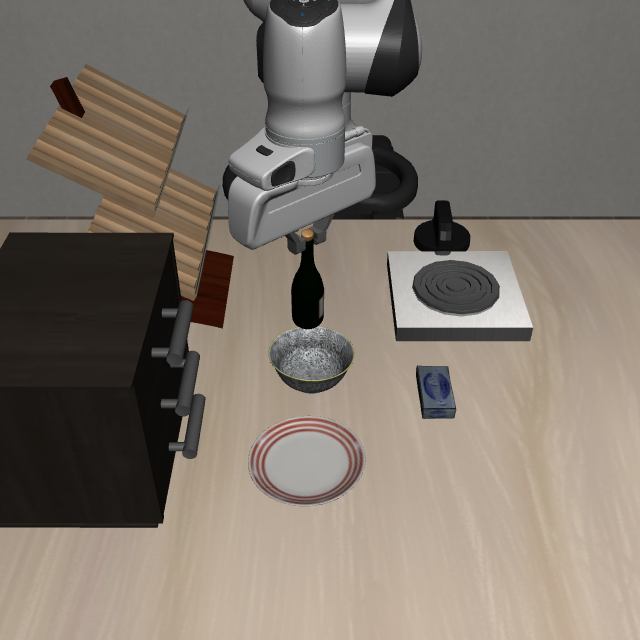
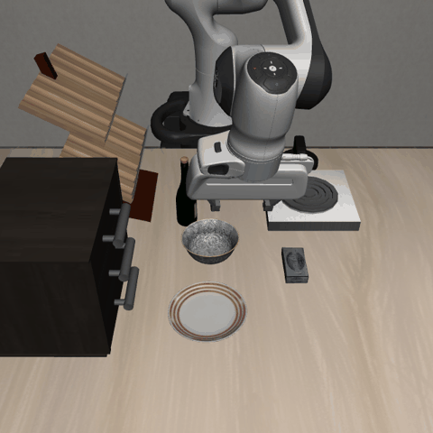
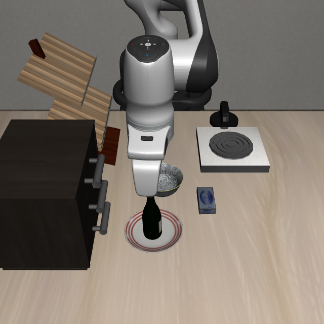

# RGB-D 静态盒尺寸修复与完整回放验证

日期：2026-10-16。分支 `feature/rgbd-recovery`，本地基线 HEAD `62e4bc8410bcf1211c8b86dc8263746f2c8a6795`；本轮新增修改尚未提交。

## 结果

已修复 RGB-D 静态观测盒被强制放大至 35 mm 的接口错误。保存的失败问题现在可规划，bottle→plate 回归实际成功。bottle→bowl 已执行抓取并进入放置悬停，但在传感器第 125 步被瓶子视觉跟踪器拒绝，未完成松手和最终任务。

| 验证 | 结果 | 实际动作与最终评估 |
|---|---|---|
| 保存的 bowl 问题，种子 0 | feasible，11 个满足约束候选 | 包含 Pick、Place、松手的运动计划；此行不执行仿真 |
| bowl，仅修复尺寸、原验收规则 | 规划通过，恢复器误报 true | 执行器认为初始状态已满足目标，0 个计划执行步；最终仿真 false |
| bowl，追加 RGB-D 碗目标验收 | 实际抓起瓶子，向碗移动 | entry lift 5 步，计划执行 75 步；传感器步号 125 发生跟踪异常；最终仿真 false |
| bottle→plate 回归 | 恢复器 true | 合计 139 环境步，其中计划执行 134 步；最终仿真 true |

规划候选数不是成功率。两次 bowl 回放从同一初始检查点独立开始，没有承接上一轮抓取后的状态。完整回放未固定优化采样种子，因此不应将不同回放的粒子数量当作严格随机对照。

## 修改范围

`experiments/robot/libero/tiptop_repro/real_cutamp_backend.py` 的 `_cuboid_dims`：当且仅当对象为 `role=static` 且 `geometry.source=rgbd_observed_anchor_obstacles` 时，使用测量半尺寸的两倍。保留 `_half_extents_xyz` 原有数值下限、观测 padding、盒子中心和数量。普通物体代理、其他来源静态盒和 surface 的尺寸下限保持原样。

本次传入原生规划器的 564 个 RGB-D 静态盒全部核验为测量尺寸；188 个碗壁盒全部保留。例如 `rgbd_obstacle_0451` 为 2×2×2 mm，未再变成 35×35×35 mm。支撑面高度、碰撞代价阈值与稳定支撑容差没有修改。

为保护历史实验，服务器上复制了冻结运行代码为本轮 `runtime_overlay`，仅在副本的 backend 中插入相同尺寸分支。视觉代码也复制为独立 `code`。冻结库本身的 backend 在实验前后 SHA256 均为 `2ee311fc60f0e0209c42efe4cc051acf4a16e78eed92a3e3a001a313581e87a4`。

## 新暴露的执行验收误判

尺寸修复后，旧执行器第一次拿到了完整放置计划，却在 `__start__` 目标检查时直接退出：

- 检查条件为水平中心距离小于 0.13 m、目标与支撑 z 差大于 -0.04 m、夹爪张开。
- 当前瓶子离碗中心约 0.121898 m，仍在碗外桌面；旧规则已返回 `all_goal_atoms_satisfied`。
- 因此 `recovery_success=true`，但实际 `executed_steps=[]`、计划执行步数 0、最终仿真 false。

为继续验证实际动作，增加 `visual_placement_verification.py`，并在视觉执行 hook 中仅为已测量的 RGB-D 碗目标安装该检查：瓶子底部轮廓须位于测得支撑圆内，底部高度与支撑高度差不超过 10 mm，且执行器报告夹爪张开。它使用当前 RGB-D 跟踪位置、拟合瓶身半径与初始测量碗支撑，不查询仿真任务成功信号。其他目标继续使用原检查。

这是几何观测验收，依赖直立瓶子、静止支撑与执行器现有开指状态定义；不是接触、释放或时间稳定性的独立证明。最终仿真成功仅在回放结束时作为评估标签读取。

## 碗的实际执行卡点

追加验收后，瓶子被抓起，进入 `Place(...):hover`。80 条环境动作事件包含 5 条入场抬升和 75 条计划动作。最后一步仍为夹持移动，没有执行放置松手。

第 124 步最后一次接受的 RGB-D 跟踪记录：1926 个观测点，拟合残差中位数约 1.268 mm，瓶底高度约 0.945166 m。第 125 步抛出 `ValueError: current RGB-D bottle tracking unresolved`，回放记录最终仿真 false。





对保存的失败帧做离线筛选诊断，仍可得到 1833 个瓶子颜色/深度候选点，空间高度范围约 147 mm。固定半径圆柱拟合的中位误差约 2.132 mm、95 分位约 5.231 mm，超过跟踪器的 2 mm / 5 mm 门限，候选被拒绝。这是移动后的形状拟合验收失败，不能等同于 DINO 没有检测到类别。

这项离线诊断将搜索中心设为最后接受的轴位置，未恢复未保存的第 124 步末端位移；不是原函数执行现场的逐位复现。拟合门限与候选点筛选规则保持原实现，方法和数值保存在 `tracker_failure_analysis.json`。下一步应核查移动时的可见表面、姿态和固定半径直立假设，而非把本次失败归因于碗壁盒尺寸。

## Plate 回归

复用此前成功 episode 的初始状态、检测模型及控制配置，保留该对照原有的障碍策略。修改后的静态盒转换下，瓶子实际放到盘子上，139 环境步，最终仿真判定 true。



## 复现与证据

仅使用用户指定的 `可上网GPU资源 / xinghanbo-eval`。根目录为 `/inspire/hdd/project/feelingai/chenwenming-25012/jxs/xinghanbo`。冻结运行库 HEAD 为 `7128c1ea6280c227e48561e621fe9da8604c5a6d`，历史运行代码及参考日志未覆盖。

第一阶段命令（`--run-dir` 必须为尚不存在的新目录）：

```bash
export ROOT=/inspire/hdd/project/feelingai/chenwenming-25012/jxs/xinghanbo
"$ROOT/envs/rlinf-openpi/bin/python" \
  "$ROOT/logs/rgbd_static_box_fix_20261016_staging/run_rgbd_static_box_fix_validation.py" \
  --run-dir "$ROOT/logs/rgbd_static_box_fix_20261016" \
  --runtime-reference "$ROOT/logs/continual_skill_core60_pilot_20261006/runtime_repo" \
  --visual-code-reference "$ROOT/logs/rgbd_labeled_obstacles_20261016/code" \
  --bowl-reference "$ROOT/logs/rgbd_labeled_obstacles_20261016/bowl" \
  --plate-reference "$ROOT/logs/rgbd_bowl_support_20261016/plate_regression" \
  --diagnostic-script "$ROOT/logs/rgbd_constraint_diagnosis_20261016/diagnose_rgbd_bowl_constraints.py" \
  --dimension-test "$ROOT/logs/rgbd_static_box_fix_20261016_staging/test_rgbd_static_box_dimensions.py"
```

第一阶段结束后执行 `"$ROOT/envs/rlinf-openpi/bin/python" "$ROOT/logs/rgbd_static_box_fix_20261016_staging/strict_bowl_followup/followup.py"`，会建立新的 `code_strict_bowl` 和 `bowl_strict_acceptance`，只追加碗验收检查。完整子进程命令及环境分别记录在各 case 的 `command.json`，输入 BDDL、配置和初始状态哈希记录在 `input_manifest.json`；第二阶段源码哈希见 `strict_bowl_manifest.json`。

检测掩码数组、拟合瓶子/碗模型、静态盒中心和半尺寸与参考的比较结果见 `validation_audit.json`。实际运行源码、阶段启动脚本、完整轨迹事件、原生问题及求解结果、RGB-D 快照随证据包保留。外部模型和环境沿用既有服务器资产，证据包不是独立运行容器。

本地针对尺寸转换、视觉初始状态、障碍构建和新增放置验收的 18 项测试通过；服务器尺寸检查 2 项通过。原始结果汇总见 `rgbd_static_box_fix_20261016_summary.json`，命令汇总见 `rgbd_static_box_fix_20261016_commands.json`，归档核验见 `rgbd_static_box_fix_20261016_evidence.json`。
